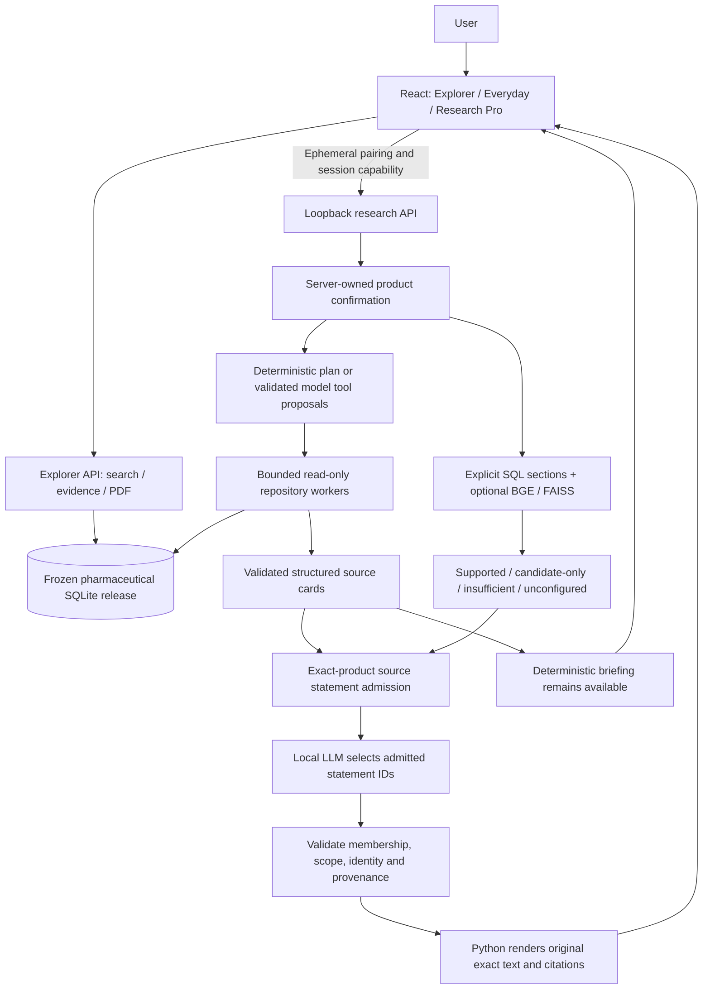

# Dav AI — Pharmaceutical Intelligence, with Traceable Evidence

Dav AI is a graduate AI/ML and full-stack portfolio project built with React,
TypeScript, FastAPI, a frozen SQLite evidence release and optional local Ollama.
It explores a practical problem: a medication name alone is not enough to interpret
labels, recall applicability or adverse-event reports. Product identity, source
scope and missing evidence must remain visible.

**Local educational demonstration. Not clinically validated, FDA approved or a
medical recommendation service.** Repository presentation does not authorize
hosting or distribution of the pharmaceutical dataset.

## Explore the application


[Mobile landing](docs/ai/screenshots/phase5/landing-mobile.png) ·
[Operational Overview](docs/ai/screenshots/phase5/overview-desktop.png) ·
[Everyday real results](docs/ai/screenshots/phase5/everyday-real-desktop.png) ·
[Research Pro real results](docs/ai/screenshots/phase5/research-pro-real-desktop.png)

Result captures use the real local API and frozen evidence. Independent support
review remains pending; screenshots do not establish clinical correctness.

| Experience | Purpose |
|---|---|
| Home `/home` | Original aqua/mint landing, illustrated source trail and workflow introduction |
| Evidence Explorer `/` | Search exact products, inspect recall/FAERS evidence, follow sources and download an evidence PDF |
| Ask Dav AI `/ask` — Everyday | Guided product confirmation and readable evidence cards |
| Ask Dav AI `/ask` — Research Pro | Cohort organization, explicit single-product research and detailed provenance |
| Operational Overview `/overview` | Illustrated identity → retrieval → source-review workflow |
| About `/about`, FAQ `/faq` | Academic motivation, methods, setup and interpretation limits |

The original teal typography, SVG workflow graphics and dark supporting-page
banners are retained. Mobile navigation, keyboard focus, FAQ disclosures and
reduced-motion behavior are included. Cohort membership alone does **not** execute
batch research; switching confirmed products requires a fresh session and confirmation.

## What it demonstrates

- **Identity before inference:** exact product/formulation/NDC resolution and
  explicit human confirmation, including singleton results.
- **Structured evidence:** admitted exact-product labels, historical product/package
  recalls and ingredient-level FAERS reporting, with coverage and source limitations.
- **Hybrid RAG:** section-aware SQL retrieval combined with optional BGE-small
  embeddings and product-scoped FAISS retrieval. Similarity candidates do not
  authorize a generated answer.
- **Bounded agentic workflow:** a local model can propose read-only tools;
  Python validates tool names, arguments, identity, budgets and source contracts.
  Explicit deterministic execution works without model planning.
- **Optional grounded answers:** Python extracts admitted statements; the model
  selects session-scoped IDs; Python reconstructs exact text, headings and citations.
  Invalid output or unsupported evidence retains the deterministic source briefing.
- **Source review:** clickable citations, original section text, dates, label
  versions, release provenance and PDF reporting in the Explorer.

## Architecture



The LLM cannot confirm products, change a session binding, promote candidate-only
passages, invent accepted statement IDs or rewrite displayed clinical source text.
Every inference has payload and deadline bounds. Citation resolution remains a
mechanical check, not proof of question relevance, clinical completeness or factual
support. [Lifecycle and security boundaries](docs/architecture/AGENTIC_RESEARCH_ARCHITECTURE.md).

Technology: React 19 / TypeScript / Vite, FastAPI / Pydantic, Python 3.13, read-only
SQLite, optional BGE-small (384 dimensions) / FAISS, optional approved Ollama models,
pytest / Vitest / Playwright and the existing PDF report renderer. No hosted model
or new agent framework is required.

## Evaluation and verification

Phase 3B used unchanged source-annotated development/holdout datasets: seven
answerable and fifteen negative/adversarial cases. The ID-selection protocol
accepted **7/7 answerable cases**, compared with **2/7** for the copying protocol.
All **12/12 citations** resolved to exact admitted source spans with consistent
product identity. The fifteen negative/adversarial cases displayed no answer text;
two deliberately simulated invalid output rather than calling a real model.

**This is automated acceptance on a small, previously observed pilot. Independent
claim-support and question-relevance review remain PENDING**, including g03/h01.
There is no human-reviewed support percentage and no zero-hallucination claim.

- [Phase 3B methodology, ablation and limitations](docs/ai/PHASE3B_GROUNDED_ANSWER_RELIABILITY.md)
- [Original raw results](docs/ai/evaluation/phase3b-v1/cases.json)
- [Independent review checklist](docs/ai/INDEPENDENT_REVIEW_CHECKLIST.md)
- [Historical tool-planning benchmark](docs/ai/AGENT_EVALUATION_RESULTS.md): distinct
  tasks and denominators; its model failures remain recorded.
- [Phase 5 readiness report](docs/ai/PHASE5_RELEASE_CANDIDATE.md): current test counts,
  real versus mocked journeys, browser availability and remaining work.

Current working-tree verification: **1,087 backend passed / 29 skipped**,
**241 agent passed** (a backend subset), **86 frontend passed**, **11 mocked
Playwright journeys passed**, **one real Explorer/PDF journey passed**, and a
**real three-stage Ask/Research Pro integration passed**. ESLint, TypeScript/Vite,
`pip check` and seven required release checks passed. RAG checks: **45 passed /
2 skipped** because FAISS is unavailable. Chromium was exercised; Firefox/WebKit
were not installed. Complete skips and scope are in the readiness report.

The optional BGE model/corpus/index are external artifacts. This checkout does not
include them. Current-host availability and unexecuted checks are explicitly listed
in the readiness report; mock embeddings are never represented as semantic retrieval.

## Run a local demonstration

Use the existing authorized release at
`data/releases/dav_ai_pharma_v1/phase4b-communications-2026-10-06/pharma.sqlite`,
or the documented `DAV_AI_PHARMA_RELEASE_DB` configuration. A Git clone alone does
not provide the dataset. Expected size: **4,825,108,480 bytes**; SHA-256:
`87779eda6b06c75f10603762b18f8c66a5cb7b12ed37d47ab1bf9b4825639c71`.
Publication remains unauthorized; never edit the artifact or its metadata.

For a new environment, Python 3.13 and Node 24 are the repository/CI targets:

```bash
python3.13 -m venv .venv
.venv/bin/python -m pip install --require-hashes --only-binary=:all: -r backend/requirements-dev.txt
.venv/bin/python -m pip check
cd frontend
npm ci
```

From the repository root, run these in separate terminals:

```bash
# Explorer API
PYTHONPATH=backend .venv/bin/python -m uvicorn app.main:app --host 127.0.0.1 --port 8000 --no-access-log
```

```bash
# Dedicated research API; requires an interactive terminal for private pairing delivery
PYTHONPATH=backend .venv/bin/python -m app.local_research
```

```bash
cd frontend
npm run dev -- --host 127.0.0.1 --port 5173 --strictPort
```

Open **http://127.0.0.1:5173/home**. In the Explorer, try an exact NDC. In Ask,
paste the current terminal capability, select and confirm a product, then research
selected evidence. For an answerable label demonstration, use Zepbound `0002-0152`
and “What serious allergy appears in the Zepbound contraindications?”. Select drug
labeling and opt into the grounded-answer checkbox if local Ollama is available.

Everyday uses deterministic evidence planning. Research Pro exposes optional model
tool planning. Grounded generation is a separate opt-in in both modes and requires
an already installed approved model. The default is `llama3.2:3b`; Research Pro can
select `qwen3.5:4b-q4_K_M` when installed. No model download is part of startup.

[Complete setup, optional RAG preparation, walkthrough and troubleshooting](docs/ai/LOCAL_DEMO_GUIDE.md).

## Interpretation and release boundaries

- FAERS associations do not establish causation, selected-NDC observations,
  incidence, comparative safety or personal risk. Never sum ingredient counts.
- Recall matches retain package/lot limitations. Missing links do not establish
  that a product has never been recalled; missing labels do not mean no warnings.
- Frozen sources are not a live safety feed. Exact source quotes can still omit
  context or answer the wrong question. Independent human review remains necessary.
- The dedicated research API is loopback-only and absent from the hosted API.
  Existing deployed-environment denials, session capabilities and release checks
  remain in place. Do not expose listeners through public binds or tunnels.
- This is a student release candidate, not a production/commercial launch or a
  finding that regulatory, clinical, privacy or security requirements are satisfied.

[Documentation index](docs/README.md) · [UI preservation report](docs/ai/UI_DESIGN_REFINEMENT.md)
· [Publication-readiness history](docs/ai/PUBLICATION_READINESS_AUDIT.md)
