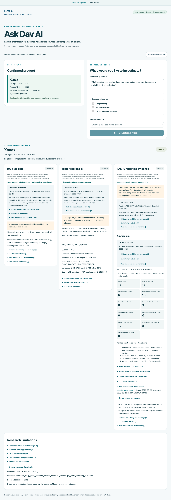
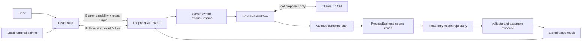

# Dav AI — Local Pharmaceutical Evidence Research

Dav AI is a graduate engineering portfolio project built with **React/TypeScript, FastAPI, SQLite and local Ollama tool calling**. A user searches for a medication, confirms an exact product, selects evidence categories and inspects a structured briefing from a frozen FDA-derived evidence release.

The model proposes read-only tools. Python validates the plan, retrieves stored evidence and assembles the briefing without a model-written medical summary. This reduces reliance on generated factual text; it does not guarantee medical correctness or protection against every attack.

**Local developer demonstration only.** This project is not represented as FDA-reviewed, FDA-endorsed or clinically validated. It provides no diagnosis, treatment recommendation or personal risk estimate. Public repository presentation and authorization to host the application are separate decisions.

## Research workspace



[Local pairing screen](docs/ai/screenshots/ask-local-connect.png) · [Mobile results](docs/ai/screenshots/ask-local-results-mobile.png)

- **Human-confirmed identity:** Candidate cards show strength, form, ingredients and product/package NDCs. Even a singleton requires explicit selection and confirmation. Changing products requires a new session.
- **Three evidence scopes:** Admitted exact-product label text; historical recalls with package/lot applicability; and ingredient-level FAERS reporting associations. Missing evidence remains unavailable or incomplete.
- **Transparent routing:** Native model-selected tools and backend completion are recorded separately. Explicit deterministic execution also works without model inference.
- **Local authorization:** A dedicated loopback API owns Python sessions, validates per-session capabilities and enforces admission, expiry and cancellation.
- **Bounded execution:** Repository reads use killable subprocesses and existing read-only release guards. Results are polled from an asynchronous task; there is no token streaming.

FAERS counts do not establish causality, incidence, comparative safety or individual risk. Ingredient counts must not be summed into a product total. A historical recall match does not establish that every lot or package was affected. An unavailable label does not mean a drug has no warnings.

## Architecture



The browser sends opaque references, not database product IDs or owner identities. The user confirms through the frontend; the LLM cannot authorize confirmation. Invalid tool names, extra arguments, duplicate calls and foreign references fail validation. A valid nonempty subset can receive explicit backend completion in `auto` mode; invalid plans do not receive that fallback.

See the [architecture and lifecycle diagrams](docs/architecture/AGENTIC_RESEARCH_ARCHITECTURE.md) for the exact boundary and limits. Process isolation and payload/deadline limits are not an OS resource sandbox or a claim of hard CPU/RAM quotas.

## Measured evaluation, with scope

The authoritative recorded runs use corpus **1.0.0** (35 defined cases across 20 evaluation categories). These are engineering checks against specified expectations and stored repository projections, not clinical validation.

| Recorded run | Observed result | Scope |
| --- | --- | --- |
| Mode A, `run_mode_a_1792700177` | 35/35 case assertions passed; 0.013 s total | Synthetic offline fixtures; nine cases flagged adversarial by the scorer |
| Mode B, `run_mode_b_1792700490` | 23/23 selected cases passed; 236.552 s total | Five resolver cases and 18 evidence comparisons; deterministic routing |
| Mode C, `run_mode_c_1792700694`, Llama `llama3.2:3b` | 7/8 exact tool-set matches; **7/8 overall case passes** | One repetition of eight selected cases; one backend completion |
| Same Mode C run, Qwen `qwen3.5:4b-q4_K_M` | 8/8 exact tool-set matches; **6/8 overall case passes** | Same eight cases; no backend completion |

Mode C median model-request / end-to-end times were **1.160 / 6.645 s** for Llama and **3.023 / 8.811 s** for Qwen, each across eight trials. The run contains unresolved expected-status failures and scorer limitations. Its planning scores do not establish general model superiority, reliable clinical behavior or universal workflow completion.

[Evaluation results and metric definitions](docs/ai/AGENT_EVALUATION_RESULTS.md) link to the original JSON and distinguish this eight-case run from the earlier six-case Agent v2 benchmark. Raw recorded artifacts were not rewritten to remove failures.

## Frozen evidence release

Release: `dav-ai-pharma-v1-phase4b-communications-20261006`.

| Stored table / property | Verified value |
| --- | --- |
| Products | 116,741 stored rows; 95,426 marked `NORMAL_CONSUMER`, 21,315 `REGULATORY_ONLY` |
| Labels | 83,684 stored rows; not all are admitted exact-product labels |
| Recalls | 17,974 stored records; 3,332 product-recall link rows |
| FAERS summaries | 3,174 stored `ae_summary` rows; not a count of individual reports |
| Database | 4,825,108,480 bytes (about 4.83 decimal GB) |
| SHA-256 | `87779eda6b06c75f10603762b18f8c66a5cb7b12ed37d47ab1bf9b4825639c71` |

These are table counts verified by read-only queries and release metadata, not an endpoint-coverage claim. Runtime search filters consumer eligibility and bounds returned candidates. The NDC observation date is **2026-09-26**, label export **2026-09-25**, recall export **2026-09-25**, and FAERS export **2026-09-23** with reporting window **2020-01-01–2026-06-30**. The build timestamp is **2026-10-06T22:12:24.015723+00:00**. The entire database does not share the FAERS window as a freshness cutoff.

The large artifact is excluded from Git. A clone alone does not supply it; no public download/distribution authorization is provided here. `publication_validated=false` remains unchanged.

## Local demonstration

Requires the existing authorized frozen release and installed development dependencies. CI targets Python **3.13** and Node **24**. The audit machine used Python **3.13.7**, Node **25.9.0**, npm **11.12.1**, React **19.2.5** and FastAPI **0.136.1**; these observations are not a cross-platform certification. The interactive launcher requires `/dev/tty`.

From the repository root, in an interactive terminal:

```bash
PYTHONPATH=backend .venv/bin/python -m app.local_research
```

In another terminal:

```bash
cd frontend
npm run dev -- --host 127.0.0.1 --port 5173 --strictPort
```

Open `http://127.0.0.1:5173/ask`, paste the terminal capability and click **Create local session**. Search `0009-0029`, select the candidate, click **Confirm selected product**, then **Research selected evidence**.

Ollama is optional for explicit deterministic execution. Model planning requires an already-running loopback Ollama service and an installed approved model: `llama3.2:3b` or `qwen3.5:4b-q4_K_M`. No paid cloud inference API is used by this workflow. This is not an air-gapped system: local HTTP processes, dependency installation, external source links and separate data-ingestion utilities exist.

[Demo guide and troubleshooting](docs/ai/LOCAL_DEMO_GUIDE.md).

## Verification

At the documentation audit, the existing checks passed: **932 backend tests** (27 skipped, seven artifact tests separately deselected), **177 agent tests**, **246 security tests**, **seven required artifact checks**, and **17 frontend tests**. Agent/security counts are subsets of the backend suite, not additional tests to sum. TypeScript/Vite build and ESLint passed. The preceding application milestone also recorded four mocked Playwright journeys, one offline real-release explorer journey and a real Qwen browser-to-Agent v2 run; these browser/model runs were not rerun for documentation-only changes.

```bash
PYTHONPATH=backend .venv/bin/python -m pytest backend/tests/agent -q
PYTHONPATH=backend .venv/bin/python -m pytest backend/tests -m 'not release_artifact' -q
PYTHONPATH=backend .venv/bin/python -m pytest backend/tests/security -q
PYTHONPATH=backend .venv/bin/python -m pytest backend/tests/pharma_release -m release_artifact --require-pharma-artifact -q
```

In `frontend`, run `npm run lint`, `npm run build`, `npm test`, and, when local browser execution is available, `npm run test:e2e`. These are bounded regression checks, not a security certification. [Audit report and actual verification](docs/ai/PORTFOLIO_DOCUMENTATION_AUDIT_REPORT.md).

## Publication and deployment boundaries

The local research API is absent from the normal hosted app. Existing environment detection and `connect_release()` reject configured deployed modes. Detection examines specific environment markers, not every possible cloud platform; the publication flag is not a cryptographic authorization mechanism. Do not spoof local environment values or expose the listener through a tunnel.

Repository publication still needs human review of tracked history, historical local paths/contact data, evaluation responses, screenshots and untracked research. Tests and a targeted text scan do not establish that a repository contains no secrets. Clinical or commercial use would require a separate regulatory, legal, privacy, safety and product-specific review; this project makes no determination that a particular clearance or standard applies.

- [Publication-readiness audit](docs/ai/PUBLICATION_READINESS_AUDIT.md)
- [Resume and LinkedIn content](docs/ai/PORTFOLIO_RESUME_CONTENT.md)
- [Evaluation framework](docs/ai/AGENT_EVALUATION_FRAMEWORK.md)
- [Historical Agent v1 report](docs/ai/AGENT_V1_IMPLEMENTATION_REPORT.md)
- [Historical Agent v2 report](docs/ai/AGENT_V2_IMPLEMENTATION_REPORT.md)
- [Ask Dav AI implementation and screenshots](docs/ai/ASK_DAV_AI_IMPLEMENTATION_REPORT.md)
