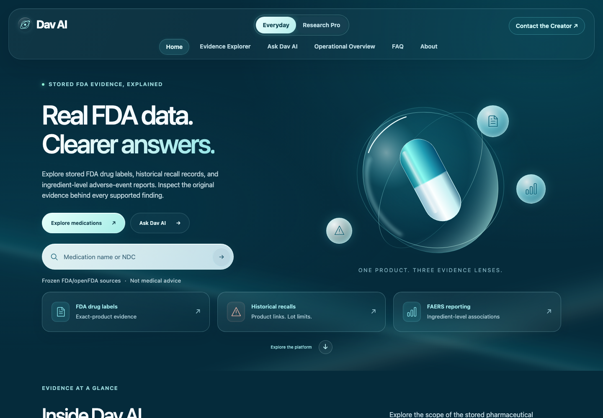
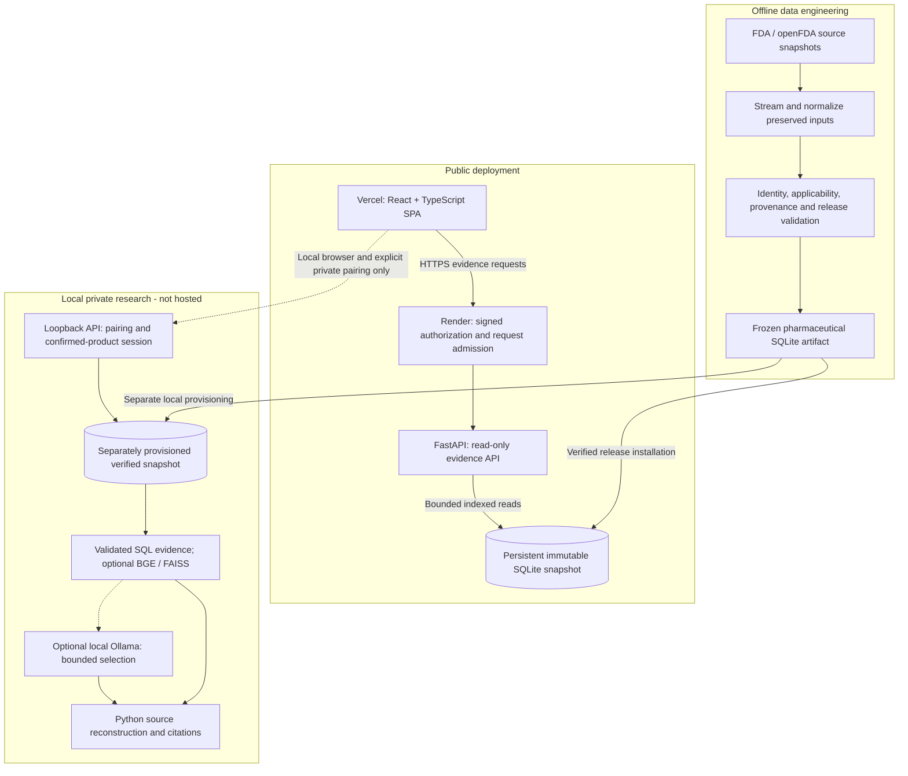

# Dav AI — Evidence-Grounded Pharmaceutical Intelligence

Dav AI connects medication search to preserved FDA drug labels, historical recall
reasons and ingredient-level adverse-event reporting. It addresses an engineering
problem behind pharmaceutical search: a matching drug name does not establish
product identity, evidence applicability or clinical meaning.

**[Live demonstration](https://dav-ai.vercel.app)** ·
[Source code](https://github.com/ChanduEsukula/dav-ai) ·
[Architecture](#system-architecture) ·
[Grounded-answer design](docs/ai/PHASE3B_GROUNDED_ANSWER_RELIABILITY.md) ·
[Documentation](docs/README.md)

Built by **Chandu Esukula** as a noncommercial academic engineering portfolio.
**Not medical advice, clinically validated software or an FDA-affiliated service.**



*Local capture of the current frontend. Decorative 3D motion has a reduced-motion
fallback; this screenshot is not an API availability or clinical-validation claim.*

## Engineering highlights

- **Full-stack evidence exploration:** React/TypeScript on Vercel, a restricted
  FastAPI API on Render, medication-level discovery and compact exact-product
  selection. Everyday and Research Pro share evidence boundaries while changing
  presentation density. [Frontend](frontend/src/App.tsx) ·
  [Discovery service](backend/app/services/pharma/medication_overview.py)
- **An immutable relational release:** a **4.83 GB** SQLite snapshot with **19
  tables** and **116,741 retained product records**, including regulatory-only
  rows excluded from public consumer search. Identity, evidence links, provenance
  and missing-data states are modeled separately. These are corpus counts, not
  counts of medications with complete evidence.
  [Schema](scripts/pharma_release/schema.py) ·
  [Identity pipeline](scripts/pharma_release/identity.py)
- **Query optimization without changing data:** existing composite indexes,
  explicit join order and bounded prefix lookups replace broad catalog scans.
  VM-instruction-budget regressions check work independently of machine speed;
  equivalence tests retain discovery priority, ordering and pagination.
  [Repository](backend/app/db/pharma/release_repository.py) ·
  [Regression tests](backend/tests/pharma_release/test_catalog_query_performance.py)
- **Grounded local AI:** the model selects admitted statement IDs; Python
  reconstructs source text and citations. Product scope, offsets, versions and
  hashes are checked before display. Invalid selections fall back to a
  deterministic evidence briefing. [Implementation](backend/app/agent/synthesis.py)
- **Fail-closed public serving:** Ed25519 approvals bind the artifact, application
  digest, service identity and allowed operations. Immutable database access,
  request admission limits, query deadlines and bounded responses protect the
  public API. [Authorization](backend/app/security/production_authorization.py) ·
  [Request boundary](backend/app/services/public_evidence.py)

## What works where

| Capability | Public demonstration | Local/restricted implementation |
|---|---|---|
| Home, FAQ, About, architecture walkthrough | Available | Available |
| Medication search and brand-level evidence overview | Read-only API | Same frozen evidence repository |
| Exact-product identity, admitted labeling, historical recall reasons | Available where stored evidence supports them | Available |
| FAERS charts and reporting summaries | Ingredient-level associations with scope warnings | Same reporting boundaries |
| PDF evidence export | **Unavailable through the public API** | ReportLab renderer and local export workflow |
| Everyday / Research Pro research execution | **Unavailable through the public API** | Private paired sessions; explicit product confirmation |
| Ollama planning, optional grounded answers, FAISS retrieval | **Not hosted** | Requires separately provisioned local models/artifacts |

Selecting Research Pro changes the interface; it does not grant access to a
hosted model. The public Everyday experience is primarily a source-grounded
Evidence Explorer, not an unrestricted chatbot.
[Public operation scope](backend/app/security/production_authorization.py) ·
[Local research launcher](backend/app/local_research/__main__.py)

## System architecture



The public API reads a frozen release; it does not query openFDA or run ingestion
on each request. Offline stages preserve source identifiers and dates, reconcile
identity and evidence relationships, and validate a new artifact before use.
The public service verifies the pinned artifact and opens SQLite with read-only,
immutable access. Local research has its own loopback listener and session
capabilities; its modules are excluded from the production image.
[Source handling](scripts/pharma_release/sources.py) ·
[Label extraction](scripts/pharma_release/label_sources.py) ·
[Release connection](backend/app/db/pharma/release_connection.py) ·
[Image boundary](.dockerignore)

## Technology stack

| Area | Technologies | Engineering purpose |
|---|---|---|
| Frontend | React 19, TypeScript, Vite, Motion, React Three Fiber/Three.js, Radix Select | Responsive glass UI, lazy 3D scene, accessible controls and reduced-motion behavior |
| Backend | Python 3.13, FastAPI, Pydantic, Uvicorn | Typed evidence contracts, validation, routing and bounded serving |
| Database / data processing | SQLite, SQL, DuckDB, PyArrow, preserved JSON/Parquet/ZIP inputs | Offline ingestion, relational identity/evidence modeling and immutable release reads |
| Applied AI / RAG, local only | Ollama adapter, optional BGE-small and FAISS, reciprocal-rank fusion | Bounded model planning, product-filtered passage retrieval and source selection |
| Testing | pytest, Vitest, Testing Library, Playwright/Chromium | Security, source contracts, release integration, components and browser journeys |
| DevOps | Docker, hash-locked Python dependencies, GitHub Actions, Vercel, Render | Reproducible runtime packaging, CI checks and separate frontend/API hosting |
| Security | Ed25519, SHA-256, capability-based local sessions, read-only SQL | Explicit serving approval, artifact/code binding and research isolation |

Versions and dependency boundaries are defined in
[frontend/package.json](frontend/package.json),
[backend runtime requirements](backend/requirements.txt) and
[development lock](backend/requirements-dev.txt).
PostgreSQL remains in historical/offline tooling and some tests; the public
pharmaceutical API uses SQLite and does not require a PostgreSQL service.
[CI runtime import check](.github/workflows/ci.yml)

## Key engineering challenges and solutions

| Challenge | Engineering decision | Observed outcome and evidence |
|---|---|---|
| Large, heterogeneous pharmaceutical inputs | Stage offline ingestion, preserve source identities, model relationships explicitly and validate immutable releases | A 19-table runtime release separates retained records from consumer eligibility. [Pipeline](scripts/pharma_release/phase4b_communications.py) · [Schema](scripts/pharma_release/schema.py) |
| Catalog scans on constrained hosting | Match leading composite-index columns, control join order and bound normalized-name prefixes | Xanax discovery returns nine distinct product records; query-budget and legacy-result comparisons guard against regressions. These tests are not a production load SLA. [Tests](backend/tests/pharma_release/test_catalog_query_performance.py) |
| Evidence leaking across strengths, formulations or similar names | Resolve sealed product identifiers; admit labels only after exact-product, ingredient, formulation and conflict checks | Withheld labels remain unavailable, even when similar products have evidence. [Admission tests](backend/tests/pharma_release/test_consumer_label_admission.py) |
| Models failing to copy exact excerpts reliably | Replace model-authored copying with statement-ID selection and deterministic reconstruction | A recorded seven-question pilot improved automated acceptance from 2/7 to 7/7; independent support/relevance review remains pending. [Methodology and ablation](docs/ai/PHASE3B_GROUNDED_ANSWER_RELIABILITY.md) |
| A public explorer sharing a codebase with private AI tools | Separate the loopback research service from the public allowlist and source-only runtime image | Tests exercise public evidence success and reject hosted research/PDF operations. [Security tests](backend/tests/security/test_production_activation.py) · [Packaging tests](backend/tests/deployment_foundation/test_public_api_context.py) |
| Read-only data access mistaken for permission to publish | Require a signed, expiring artifact/code/service-bound approval in addition to file integrity checks | Wrong signatures, deployment identity, scope, expiry and file layouts fail closed. Historical artifact metadata is never rewritten to authorize serving. [Signature validator](backend/app/security/publication_candidate.py) |

## Applied AI and retrieval engineering

The local research workflow is deliberately narrower than open-ended medical
question answering:

1. **Confirm identity.** The user selects and confirms an exact product. A
   singleton search result still requires confirmation; similar names do not
   become equivalent products.
2. **Retrieve admitted evidence.** Typed source tools produce scoped label,
   recall and FAERS cards. Optional retrieval chunks admitted label sections while
   preserving offsets and provenance. BGE-small supplies 384-dimensional embeddings;
   FAISS ranks within the confirmed product's membership, rather than filtering
   a global top-k afterward. SQL and semantic candidate lists can be combined
   with reciprocal-rank fusion.
3. **Evaluate sufficiency.** Retrieval distinguishes `supported`, `candidate_only`
   and `insufficient_evidence`. Similarity alone does not authorize an answer.
4. **Constrain model output.** For optional grounded answers, Ollama selects
   session-scoped statement IDs in strict JSON. It supplies neither medical prose
   nor citation metadata.
5. **Reconstruct or abstain.** Python validates the selection against the current
   admitted source units, reconstructs original text and citations, and rejects
   stale, foreign, invented or inconsistent output. The deterministic briefing
   remains available when synthesis cannot be accepted.

[Retrieval index](backend/app/agent/rag/index.py) ·
[Embedding adapter](backend/app/agent/rag/embeddings.py) ·
[Sufficiency policy](backend/app/agent/rag/hybrid.py) ·
[Workflow adapter](backend/app/agent/rag_adapter.py) ·
[Answer validation](backend/app/agent/synthesis.py)

**Evaluation boundary:** the recorded grounded-answer pilot is small and previously
observed. Exact-source reconstruction demonstrates mechanical traceability, not
clinical correctness, question relevance or comprehensive context. The recorded
report lists 12/12 exact citation resolutions and pending independent review;
it does not establish a general hallucination rate. Optional BGE/FAISS adapters
are implemented, but the historical RAG report records missing semantic dependencies
and external artifacts. Mock embeddings are contract-test scaffolds, not semantic
retrieval results. No local model or index is claimed to run on Render.
[Recorded analysis](docs/ai/PHASE3B_GROUNDED_ANSWER_RELIABILITY.md) ·
[RAG experiment scope](backend/app/agent/rag/README.md)

## Testing and quality engineering

Verification during this README refresh, against backend/frontend source at
`9076227`:

| Check | Result | Scope |
|---|---|---|
| Targeted backend suite | **415 passed** | Security, public image boundary, catalog query performance and medication overview; includes **20 required artifact checks** |
| Frontend unit/component tests | **165 passed, 18 files** | Vitest and Testing Library |
| ESLint | Passed | Frontend |
| TypeScript + Vite | Passed | Production frontend build |

These are separate scoped runs, not a cumulative project-wide test count. The
backend run emitted an existing Starlette test-client deprecation warning.
The 3D scene is lazy-loaded, but its transfer/parse cost remains a performance
tradeoff; a passing build does not establish a browser performance budget.
Browser suites are implemented for navigation, modes, dropdowns, accessibility
interactions and local evidence journeys; they were **not rerun as a suite** for
this documentation change. A local Chromium homepage capture was taken.

Reproduce the focused backend checks with the separately provisioned artifact:

```bash
PYTHONPATH=backend .venv/bin/python -m pytest \
  backend/tests/security \
  backend/tests/deployment_foundation/test_public_api_context.py \
  backend/tests/pharma_release/test_catalog_query_performance.py \
  backend/tests/pharma_release/test_medication_overview.py \
  --require-pharma-artifact -q
```

For a clone without the artifact, CI runs source-only checks explicitly:

```bash
PYTHONPATH=backend .venv/bin/python -m pytest backend/tests -m 'not release_artifact' -ra
```

Then, from `frontend/`:

```bash
npm test
npm run lint
npm run build
npm run test:e2e
```

Playwright needs its Chromium browser installed. The separate
`test:e2e:release` suite requires the local verification API and real artifact;
it is not a hosted AI test. Optional RAG checks use
`PYTHONPATH=backend .venv/bin/python -m pytest backend/tests/rag -q` and report
missing dependencies as skips.
[CI workflow](.github/workflows/ci.yml) ·
[Browser configuration](frontend/playwright.config.ts) ·
[Real-evidence browser tests](frontend/e2e/pharma-offline.spec.ts)

## Deployment and live demonstration

Visit **https://dav-ai.vercel.app**. Search a medication such as Xanax, inspect
available evidence across matching products, then expand a specific strength,
dosage form and labeler to review product-scoped records and original sources.
An empty evidence panel is a coverage limitation, not an assurance of safety.

Vercel serves the SPA; Render runs the non-root FastAPI container with a persistent
SQLite release. The hosted API is restricted and read-only. Signed authorization
is checked independently of artifact integrity, and private research, pairing,
Ollama, FAISS and PDF operations are not exposed through the public boundary.
The React experience selector does not change those backend permissions.
[SPA routing](frontend/vercel.json) · [API container](backend/Dockerfile) ·
[Public boundary](backend/app/services/public_evidence.py)

GitHub Actions validates code and builds artifacts; the checked-in workflows do
not constitute an automatic Vercel/Render deployment pipeline. GCP foundation
files are separate deny-only infrastructure experiments, not the live architecture.

## Local development

Use **Python 3.13** and **Node 24**, the CI targets. A clone does **not** include
the pharmaceutical database, raw source archives, model weights or FAISS indexes.
Evidence-backed local operation requires the separately authorized frozen artifact
at the default release location or a local `DAV_AI_PHARMA_RELEASE_DB` path. The
loader verifies its pinned size, SHA-256 and schema; do not substitute a different
database or edit its metadata to make it load.

For a new environment, from the repository root:

```bash
python3.13 -m venv .venv
.venv/bin/python -m pip install --require-hashes --only-binary=:all: -r backend/requirements-dev.txt
.venv/bin/python -m pip check
npm --prefix frontend ci
```

Start the local Explorer API and UI in separate terminals:

```bash
PYTHONPATH=backend .venv/bin/python -m uvicorn app.main:app \
  --host 127.0.0.1 --port 8000 --no-access-log
```

```bash
cd frontend
npm run dev -- --host 127.0.0.1 --port 5173 --strictPort
```

Open **http://127.0.0.1:5173/home**. Static informational pages work without a
pharmaceutical backend. The ordinary API defaults to loopback; local configuration
is documented in [frontend/.env.example](frontend/.env.example).

For restricted research, start the separate loopback service from an interactive
terminal:

```bash
PYTHONPATH=backend .venv/bin/python -m app.local_research
```

Pair the local browser using the capability delivered to that terminal, then
select and confirm a product. Deterministic research does not require Ollama;
optional model planning/synthesis needs an approved, already-installed local model.
BGE/FAISS additionally needs compatible optional dependencies and an external,
product-scoped corpus/index. Startup does not download these artifacts. Keep
pairing credentials private and do not expose the local service through a public
bind or tunnel. [Local setup and optional research](docs/ai/LOCAL_DEMO_GUIDE.md)

## Project scope and limitations

- This is a noncommercial academic engineering demonstration using historical
  pharmaceutical evidence, not individualized medical advice or an FDA endorsement.
- FAERS reporting associations do not establish causation, incidence, comparative
  safety or individual risk. Ingredient counts must not be summed into product totals.
- Historical recall links retain package/lot and date limitations. They do not
  establish current recall status or applicability to every package.
- Strength, dosage form, ingredients, identifiers and labeling matter. Similar
  names and shared ingredients do not justify exchanging evidence between products.
- Missing labels or recall links do not mean no warnings or recalls exist. Dataset
  windows differ; this snapshot is not a live safety feed.
- Exact quotations and valid citations can still omit relevant context. Independent
  clinical support review and broad real-model retrieval evaluation remain incomplete.
- Public generative research and PDF exports are intentionally unavailable.
  Repository access does not grant permission to redistribute the external data.

## Future engineering directions — not implemented commitments

- Expand independent, blinded review of answer relevance, support and abstention
  before treating automated acceptance as an answer-quality result.
- Evaluate real, provisioned semantic retrieval across a broader held-out corpus,
  including formulation confusion and missing-evidence cases.
- Add privacy-conscious production latency/resource monitoring and repeatable
  constrained-host load tests; local timings are not an availability guarantee.
- Improve reproducible release refreshes and source-vintage comparisons while
  retaining immutable historical artifacts and explicit validation gates.

## Author

**Chandu Esukula** — full-stack, data engineering and applied AI portfolio.
[GitHub](https://github.com/ChanduEsukula) ·
[LinkedIn](https://www.linkedin.com/in/chandu-esukula-a15454266) ·
[Email](mailto:esukulachandu@gmail.com)
