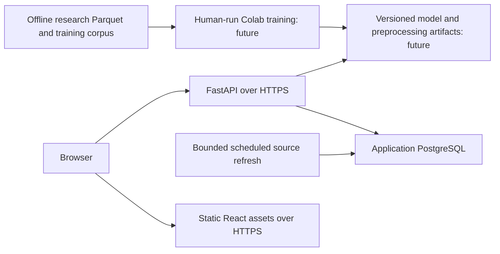

# Dav AI deployment plan — preparation only

No deployment, infrastructure purchase, model training or model integration has
been performed. This plan is grounded in the current repository. Research status
and the remaining data-quality gates are in [ml/CONTINUATION_STATUS.md](ml/CONTINUATION_STATUS.md).

## Inspected architecture and gaps

The application uses React/Vite (`frontend`), FastAPI (`backend/app/main.py`),
PostgreSQL/Alembic, official-source ingestion jobs, and a grounded Ask service.
The hard deployment target is **$0 recurring infrastructure cost; only the domain
may incur spending**. Earlier Render/Railway references are not a provider or paid
tier decision. No recurring service, automatic overage, or paid upgrade is
authorized. A free deployment is not yet proven feasible for the full application.

Read-only measurement on 2026-09-27 found **8,443,223,063 bytes (7.86 GiB)** in the
application PostgreSQL database, including 8,045,682,688 bytes for `drug_labels`.
That is separate from the research corpus and precedes future vector/model storage.
The 2.21 GB compressed backup is not the database capacity requirement. Evidence:
`docs/evidence/research-continuation-2026-09-26/application-storage.json`.

On the later continuation, the earlier temporary PostgreSQL cluster was absent.
The 7.86 GiB figure remains a saved read-only measurement, not a fresh running-server
measurement. The protected backup was rehashed successfully and was not restored
or changed. Regression tests use a separate temporary UTF-8 cluster; that cluster
contains no restored application data. See `backup-reverified.json` in the same
evidence directory.

Important preparation findings:

- The backend packaging boundary is now narrowed: the root `.dockerignore`
  excludes everything except the backend runtime code/requirements/Dockerfile and
  `data/safety_sources`. The Dockerfile copies that runtime data directory explicitly.
  Research partitions, training exports, backups, caches and temporary files are
  excluded; additional suffix rules protect against accidentally placing these in
  an allowed directory. This uses the repository-root context configured by Compose,
  following [Docker's context rules](https://docs.docker.com/build/concepts/context/).
  Static review passed. A real image build still needs verification: the local
  Docker daemon was not running, and it was not started during this data session.
- `frontend/Dockerfile` starts the Vite development server. Production must serve
  built static assets with SPA route fallback, not use that development command.
- `/health` currently reports process liveness. It does not demonstrate database
  readiness, migration compatibility, or future model readiness.
- Current authentication is documented as prototype/demo authentication. Do not
  describe it as production RBAC or tenancy. Resolve public exposure and access
  requirements before launch.
- No trained model artifact or inference API exists. Those are later work, not
  services that can be marked healthy today.

## Proposed production boundary



The 20M-report corpus, analytical DuckDB files, source ZIPs and training exports
remain in research storage. Production holds application evidence/search data,
Ask provenance, bounded displayed signals, model/version metadata, and whatever
compact inference feature store is justified after the model is selected.
Do not query the research corpus from interactive product requests.

## Hosting and runtime plan

| Component | Initial plan | Release gate |
|---|---|---|
| Frontend | A verified no-cost static hosting option; build `npm ci` then `npm run build` in `frontend`, publish `dist` | Verify current free terms, custom-domain support, SPA fallback, HTTPS, bandwidth and API connectivity |
| Backend | A no-cost CPU runtime, provider not selected | Measure model memory/latency; verify free execution quotas, sleep behavior, egress and no automatic charges |
| PostgreSQL | A durable PostgreSQL option only if its verified free allowance fits the application | Fit the measured 7.86 GiB plus growth/indexes, backups and future pgvector; do not assume a small free database tier suffices |
| Future inference | Load one verified model version per worker at startup | Artifact checksum, schema, preprocessing and calibration versions must match |
| Refresh jobs | Separate bounded worker/cron job, never an unbounded web request | Durable locking, timeout, source provenance, idempotence and failed-refresh preservation |

The existing backend start command is:

```sh
uvicorn app.main:app --host 0.0.0.0 --port "$PORT" --app-dir backend
```

Provider terms and current free limits must be checked at the later deployment
review. Include storage, backups, builds, egress, scheduled jobs, model artifacts,
embeddings and Ask/Gemini usage. Use hard quota enforcement and disable paid
fallbacks; an exhausted free allowance should pause the affected capability.
If no free configuration fits, report the constraint and leave deployment blocked.
Do not silently remove application evidence, turn a temporary trial into a permanent
plan, or claim existing-machine hosting has no availability or operating tradeoffs.

## Secrets, HTTPS, access and request limits

Store `DATABASE_URL`, `AUTH_SECRET_KEY` and configured Ask-provider API keys in the
host's secret manager/environment. Never place them in Vite variables, artifacts,
logs, Git or Docker build layers. Use a least-privilege application DB role and a
separate migration/backup role. Require encrypted database connections appropriate
to the selected host. Rotate credentials through a reviewed runbook.

Terminate HTTPS at the managed edge and redirect HTTP. Set `DAVAI_ENV=production`
and an exact `ALLOWED_ORIGINS` allowlist for deployed frontend domains. CORS is not
authentication. Restrict operational/admin endpoints and future refresh triggers.

Before public launch, implement and test per-client limits, authenticated quotas
where applicable, request/body size limits, concurrency bounds, timeouts and
Ask-provider token/cost budgets. Apply separate, tighter budgets to Ask and future
inference. Record rejected requests without logging secrets or unnecessary source
payloads. Do not claim these controls exist merely because they are planned.

## Refresh and model artifact operations

Continue using the existing application ingestion jobs and database-backed locks
for scheduled monitor work. Test the cron command from the deployed repository
root; do not copy local `/Users/...` paths into hosted job configuration. Leave
production schedules disabled until their bounded runs, locks and failure paths
are verified. Research bulk ingestion must remain separate from production cron.

After human-reviewed Colab training, publish an immutable bundle containing model
weights, feature schema, category vocabularies, train-fitted preprocessing,
calibration/decision thresholds, training dataset hash, code revision, temporal
evaluation report and artifact hashes. Pin a model version; never load an arbitrary
user-uploaded executable/pickle as a model. Validate inputs and fail clearly on
schema mismatch. Start on CPU if measured latency is adequate; GPU hosting requires
an actual benchmark and cost justification. Each worker's model memory counts.

## Health, logs, backups and rollback

Keep `/health` for liveness and add a separately scoped readiness check before
deployment that verifies database connectivity/schema and future artifact loading.
Avoid making liveness dependent on external FDA or LLM services. Track request IDs,
latency, error rates, DB saturation, refresh runs, freshness, model version, input
schema failures and inference latency. Redact secrets and avoid logging complete
Ask prompts or source records by default.

Back up application PostgreSQL on a declared schedule and retention policy, with
restore drills and agreed recovery-time/recovery-point targets. The existing
2,213,621,015-byte local recovery backup is protected and hash-verified; it is not
proof of a production backup/restore system. Back up model bundles and metadata
separately. Research snapshots use their own manifests and checksum receipts.

Run migrations as a controlled release step after a backup and rehearsal. Never
blindly `alembic stamp head` on an unverified database. Use backward-compatible
schema changes where possible. Keep the previous frontend/backend image and model
bundle available. Roll back the model atomically with its preprocessing/schema;
pause refresh jobs if they are producing bad data. Destructive schema rollback
requires a tested restore or forward-fix procedure.

## Cost controls and launch verification

Disable automatic spending/overages and paid fallback paths. Use quota alerts,
log-retention limits, DB/storage growth alerts, bounded refresh budgets and an
initial concurrency ceiling. Spending alerts alone do not enforce a $0 target. Do not bundle
the research corpus into images or continuously rebuild it in production. Measure
traffic before changing worker counts; no paid infrastructure is authorized.

Before launch: full backend/frontend tests and build; migration/restore rehearsal;
model schema/parity tests; provenance and offline-read checks; approved auth and
limits. After deployment: HTTPS, health/readiness, search, pharmaceutical detail,
Ask grounding, signal wording/version provenance, CORS, rate limits, refresh failure
preservation, and rollback smoke tests. Production deployment remains a later step.

## Remaining project roadmap

1. **Current session, in progress:** finish the pinned corpus and ML-readiness
   audit; produce usable Colab exports only if all leakage/data-quality gates pass.
   These items are not marked complete while data or availability gaps remain.
2. **Human/Colab:** train persistence/statistical baselines and PyTorch, evaluate
   on the held-out temporal test set, then select a model from measured evidence.
3. **Later Codex:** integrate the approved artifact, prediction/signal API, careful
   reporting-signal UI, provenance/versioning, and inference tests.
   Only afterward implement the documented [hybrid RAG direction](architecture/VECTOR_DB_RAG_PLAN.md).
4. **Deployment:** verify a configuration meeting the $0 recurring-cost constraint,
   then provision reviewed hosting, migrate/restore PostgreSQL, deploy
   frontend/backend/model, enable bounded refresh, smoke-test and monitor backups.
5. **After verification:** freeze v1, update README/architecture/demo. Résumé writing
   is outside this session.
