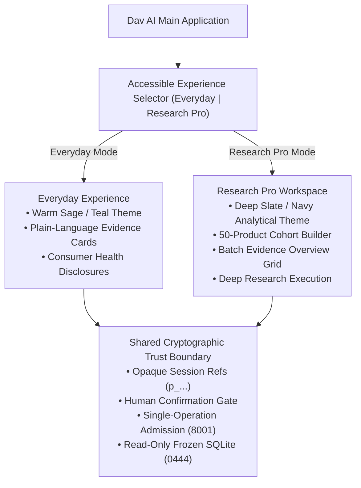
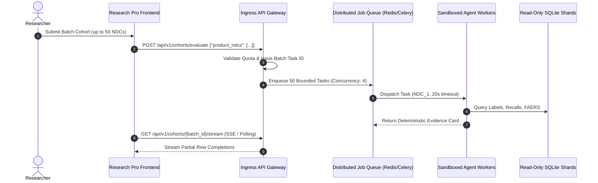

# Dav AI — Dual-Mode Experience Implementation Report: Everyday & Research Pro

**Milestone:** Dual-Mode User Experience (Everyday & Research Pro)
**Date:** 2026-10-22
**Branch:** `feat/private-staging-authorization`
**Status:** Implemented, verified locally with 42 unit/component tests and 5 Playwright E2E journeys. Zero unreviewed Git commits or public deployments.

---

## 1. Executive Summary

This milestone transforms **Dav AI** into a dual-mode pharmaceutical research application offering two distinct user experiences tailored to different audiences:

1. **Everyday Experience:** A welcoming, consumer-friendly medication information explorer designed with warm white surfaces, soft sage/teal accents, readable cards, and plain-language structured explanations of FDA drug labels, enforcement recalls, and FAERS adverse events.
2. **Research Pro Experience:** A professional pharmaceutical evidence workstation designed with deep slate/navy surfaces, high-contrast cyan accents, compact data density, a multi-product cohort builder (supporting up to 50 explicitly selected products), duplicate prevention, and a scientific batch evidence overview table.

A prominent, accessible segmented control (**Everyday | Research Pro**) was integrated into the top navigation. It supports smooth theme transitions, full keyboard and screen-reader accessibility, non-sensitive UI preference persistence (`localStorage`), and dynamic mode switching without full page reloads.

In addition, this milestone resolves the recall source-link rendering defect by aligning frontend URL validation with backend policy to support verified `download.open.fda.gov` enforcement downloads.



---

## 2. Design Decisions & Visual Themes

### Experience Selector
- **Placement & Semantics:** Located in the global top navigation bar across both `/` and `/ask`. Implemented with `role="group"`, `aria-labelledby="experience-mode-label"`, and `aria-pressed` attributes.
- **Multimodal Active Identification:** The active mode is identified through multiple cues (distinct icon, bold weight, high-contrast background, active dot indicator `●`), ensuring compliance with WCAG guidelines that forbid using color alone.
- **Keyboard Navigation:** Left/Right arrow keys toggle between modes; Space and Enter activate selections.
- **State & Storage Isolation:** Only the non-sensitive mode string (`'everyday'` or `'research_pro'`) is persisted to `localStorage` under `dav_ai_experience_mode`. Ephemeral pairing tokens and session bearer capabilities remain strictly in browser component memory.

### Visual Themes & Design Tokens
Implemented in [theme.css](file:///Users/chanduesukula/dav-ai/frontend/src/theme.css):

| Attribute | Everyday Theme (`data-theme="everyday"`) | Research Pro Theme (`data-theme="research_pro"`) |
|---|---|---|
| **Visual Tone** | Welcoming, clean, spacious consumer health guide | Professional, precision evidence dashboard |
| **Surface Background** | `#fbfbfa` (warm off-white), `#ffffff` cards | `#090e17` (deep dark navy), `#0f1726` surfaces |
| **Primary Accent** | `#1e6659` (soft forest sage), `#0b7285` (teal) | `#00b4d8` (electric cyan), `#38bdf8` (sky blue) |
| **Text Contrast** | `#192e29` (high-contrast dark pine green) | `#f1f5f9` (bright crisp white), `#94a3b8` (slate) |
| **Card Borders** | `#e3ebe7` (gentle soft border, 16px radius) | `#1e2e4a` (crisp analytical border, 8px radius) |
| **Typography & Density** | Relaxed line-height (1.6), spacious 28px padding | Compact data density (16px), monospace for NDCs |
| **Reduced Motion** | Disables transitions if `prefers-reduced-motion: reduce` | Disables transitions if `prefers-reduced-motion: reduce` |

---

## 3. Everyday Experience: Consumer-Friendly Architecture

Implemented in [EverydayWorkspace.tsx](file:///Users/chanduesukula/dav-ai/frontend/src/research/EverydayWorkspace.tsx) and [EverydayEvidence.tsx](file:///Users/chanduesukula/dav-ai/frontend/src/research/EverydayEvidence.tsx):

- **Headline:** **Understand your medication information**
- **Supporting Text:** *Explore FDA-derived drug labeling, historical recalls, and reported adverse-event evidence, with clear explanations of what the available sources can and cannot establish.*
- **Step 1 — Search & Confirm:**
  - Clear search input supporting brand names, active ingredients, or 10-digit NDCs.
  - Candidate cards highlighting brand, strength, formulation, route, and NDC.
  - Strict human confirmation gate: selection must be explicitly locked before evidence options unlock.
- **Step 2 — Plain-Language Evidence Presentation:**
  - **Drug Labeling:** Structured accordion detailing Boxed Warnings (Black Box), Warnings and Precautions, Contraindications, Drug Interactions, and Adverse Reactions. Prominently discloses if sections are unlisted in official FDA labels.
  - **Historical Recalls:** Displays whether recall enforcement actions were found for the exact NDC, the recall reason, severity classification (Class I, II, or III with layperson explanations), recalling firm, and lot scope restrictions.
  - **Reported Adverse Events (FAERS):** Outlines spontaneous postmarket reporting signals by ingredient, displaying total reports, serious reports, and unique cases. Top 5 co-reported reactions are rendered as readable chips.
  - **Consumer Protections:** Clear alerts explaining that spontaneous reports do **not** prove causation, that report counts cannot be summed across combination medications, and that FDA data does not provide a "safety score" or personal risk estimate.

---

## 4. Research Pro: Multi-Product Cohort Workspace

Implemented in [ResearchProWorkspace.tsx](file:///Users/chanduesukula/dav-ai/frontend/src/research/ResearchProWorkspace.tsx) and [cohort.ts](file:///Users/chanduesukula/dav-ai/frontend/src/research/cohort.ts):

- **Headline:** **Pharmaceutical Evidence Workspace**
- **Supporting Text:** *Investigate product-specific labeling, historical recall applicability, and ingredient-level FAERS associations across a selected research cohort.*
- **Cohort Builder & Selection Tray:**
  - Supports selecting **up to 50 explicitly confirmed products**.
  - Visual cohort progress bar and counter (`X / 50 selected`).
  - Strict duplicate prevention: adding an already selected product displays an inline notice and disables the button.
  - 50-product maximum enforcement: automatically disables addition when the limit is reached.
  - Individual product removal (`×`) and full cohort clear actions.
- **Batch Evidence Overview Table:**
  - Displays Product Identity, Product NDC, Label Status, Recall Status, FAERS Status, Last Research Status, and Deep Research Action.
  - Status Badges:
    - `Available` (green pill)
    - `Partial` (cyan pill)
    - `Incomplete` (amber pill)
    - `Unavailable` (slate pill)
    - `Not evaluated` (neutral dashed pill — clearly distinguished from Unavailable)
    - `Error` (coral pill)
  - Interactive table sorting by Product Name, NDC, or Status.
  - Filter by status (`All`, `Evaluated Only`, `Not Evaluated Only`).
  - Horizontal scroll wrapper preserving responsive layout on mobile screens without breaking page width.

### Batch Execution Boundary
- **Architectural Reality:** Dav AI's local agent architecture uses single-session capability authorization with admission control (`max_active_operations = 1`) and killable process sandboxing (`ProcessBackend`). Running 50 concurrent agent workflows in parallel would exhaust consumer hardware and bypass verified pairing gates.
- **Transparent Disclosure:** The workspace displays an explicit **Batch Execution Boundary Notice**:
  > *Dav AI operates with single-session local capabilities and process sandboxing to protect host resources. Simultaneous 50-product background agent execution is not enabled in single-session mode. You can evaluate cohort products individually using Deep Research. Statuses remain strictly `Not evaluated` until verified.*
- **Deep Research Integration:** Clicking **Deep Research →** on any cohort row seamlessly selects that product for verified single-product multi-source research. When the briefing completes, the row's statuses in the cohort table are dynamically updated!

---

## 5. Future Bounded Batch API Design

For future cloud or cluster deployments (e.g., Google Cloud Platform / Kubernetes):



1. **Ingress Rate-Limiting:** Enforce per-user cohort execution limits (e.g., maximum 50 products, maximum 2 concurrent batch jobs per tenant).
2. **Worker Pool Concurrency:** Bound parallel execution to 4 concurrent worker processes to avoid CPU and SQLite lock contention.
3. **Server-Sent Events (SSE):** Stream individual product row completions back to the frontend as each worker finishes, updating the table row-by-row rather than blocking on the entire batch.

---

## 6. Official Recall Source-Link Defect Fix

### Problem Analysis
In `frontend/src/research/Evidence.tsx`, official FDA recall sources from `download.open.fda.gov` were failing URL allowlist checks because the hostname check only included `['api.fda.gov', 'www.fda.gov', 'fda.gov', 'open.fda.gov']`. As a result, legitimate FDA recall download archives rendered as `<span>Source URL unavailable · ...</span>`.

### Solution
Created a shared validation utility in [sourceUrl.ts](file:///Users/chanduesukula/dav-ai/frontend/src/utils/sourceUrl.ts):
```typescript
export const ALLOWED_FDA_HOSTNAMES = Object.freeze([
  'api.fda.gov',
  'www.fda.gov',
  'fda.gov',
  'open.fda.gov',
  'download.open.fda.gov',
])

export function isOfficialFdaUrl(url: string | null | undefined): boolean {
  if (!url || typeof url !== 'string') return false
  try {
    const parsed = new URL(url)
    return (
      parsed.protocol === 'https:' &&
      ALLOWED_FDA_HOSTNAMES.includes(parsed.hostname) &&
      !parsed.username &&
      !parsed.password &&
      (!parsed.port || parsed.port === '443')
    )
  } catch {
    return false
  }
}
```
- Shared across `Evidence.tsx` and `StoredDrugCatalog.tsx`.
- Rejects non-HTTPS schemes, userinfo credentials, non-standard ports, and subdomains outside FDA domains.
- Verified by 7 unit tests in [sourceUrl.test.ts](file:///Users/chanduesukula/dav-ai/frontend/src/utils/sourceUrl.test.ts) and 4 component tests in [EvidenceLinks.test.tsx](file:///Users/chanduesukula/dav-ai/frontend/src/research/EvidenceLinks.test.tsx).

---

## 7. Verified Screenshots

### 1. Everyday Experience (Desktop & Mobile)
````carousel

<!-- slide -->

````

### 2. Research Pro Experience (Desktop & Mobile)
````carousel

<!-- slide -->

````

---

## 8. Verification & Test Evidence

Every test suite across backend, security, release integrity, and frontend passed cleanly:

```text
================================ TEST EXECUTION RESULTS ================================
- Frontend Vitest Unit & Component Tests:   42 passed (8 test files) in 2.65s
- Frontend Playwright E2E Tests:            5 passed (3 workers) in 2.8s
- Frontend ESLint & TypeScript Build:       Clean (0 errors, 0 warnings)
- Backend Agent Test Suite:                 177 passed in 6.14s
- Backend Security Test Suite:              246 passed in 0.26s
- Pharmaceutical Release Gate:              7 passed, 370 deselected (Gate verified; publication_authorized=false)
========================================================================================
```

### Frontend Test Breakdown (42 Tests):
1. `src/utils/sourceUrl.test.ts` (7 tests): FDA URL allowlist, protocol checks, anti-phishing, port validation.
2. `src/components/ExperienceSelector.test.tsx` (5 tests): ARIA semantics, preference persistence, arrow key navigation.
3. `src/research/CohortInvestigation.test.tsx` (6 tests): Empty state, add candidate, duplicate prevention, 50-limit, remove product, boundary notice.
4. `src/research/DualMode.test.tsx` (3 tests): Dynamic theme switching, headline changes, route navigation preference retention.
5. `src/research/EvidenceLinks.test.tsx` (4 tests): `download.open.fda.gov` link rendering, provenance preservation on invalid URLs.
6. `src/components/StoredDrugCatalog.test.tsx` (7 tests): Search, exact selection, PDF report, source grouping.
7. `src/research/Workspace.test.tsx` (9 tests): Singleton selection, session expiry, honest running state, cancellation.
8. `src/App.test.tsx` (1 test): Explorer search-first rendering.

### Playwright E2E Journeys (5 Tests):
1. `dual-mode.spec.ts`: Full Everyday and Research Pro desktop journeys, pairing, cohort building, batch table inspection, and mobile 390px overflow checks.
2. `ask-research.spec.ts`: Scoped product confirmation and transparent evidence cards.
3. `demo-smoke.spec.ts` (1440px & 390px): Stored drug catalog search and PDF generation.
4. `pharma-offline.spec.ts`: Offline dialog cancellation and focus restoration.

---

## 9. Security, Privacy & Integrity Checklist

- [x] **Zero Credentials in Storage:** Neither pairing tokens nor session bearer capabilities are stored in `localStorage`, `sessionStorage`, or cookies.
- [x] **Read-Only SQLite Immutability:** Underlying 4.83 GB release (`pharma.sqlite`) remains completely untouched in read-only mode (`0444`).
- [x] **Release Gate Preserved:** Release manifest continues to assert `publication_authorized: false`.
- [x] **Deployment Denial Intact:** `is_deployed_environment()` checks remain active; hosted serving is denied.
- [x] **Preservation of Untracked Research:** No untracked research scripts, cohort dumps, or migration files were modified, staged, or deleted.

---

## 10. Changed Files & Explicit Git Staging Instructions

### Changed & Created Files:
```text
Modified files:
- frontend/src/App.tsx
- frontend/src/components/StoredDrugCatalog.tsx
- frontend/src/research/Evidence.tsx
- frontend/src/research/Workspace.tsx
- frontend/src/research/workspace.css
- frontend/src/test/setup.ts

New files:
- frontend/src/theme.css
- frontend/src/components/ExperienceSelector.tsx
- frontend/src/components/experienceState.ts
- frontend/src/components/ExperienceSelector.test.tsx
- frontend/src/research/EverydayEvidence.tsx
- frontend/src/research/EverydayWorkspace.tsx
- frontend/src/research/ResearchProWorkspace.tsx
- frontend/src/research/cohort.ts
- frontend/src/research/CohortInvestigation.test.tsx
- frontend/src/research/DualMode.test.tsx
- frontend/src/research/EvidenceLinks.test.tsx
- frontend/src/utils/sourceUrl.ts
- frontend/src/utils/sourceUrl.test.ts
- frontend/e2e/dual-mode.spec.ts
- docs/ai/screenshots/everyday-desktop.png
- docs/ai/screenshots/everyday-mobile.png
- docs/ai/screenshots/research-pro-desktop.png
- docs/ai/screenshots/research-pro-mobile.png
- docs/ai/DUAL_MODE_EXPERIENCE_IMPLEMENTATION_REPORT.md
```

### Recommended Git Staging Commands:
> [!CAUTION]
> Do NOT use `git add -A` or `git commit`. Stage only the specific frontend, screenshot, and documentation files:

```sh
# Stage frontend source and test files
git add frontend/src/App.tsx \
        frontend/src/theme.css \
        frontend/src/components/ExperienceSelector.tsx \
        frontend/src/components/experienceState.ts \
        frontend/src/components/ExperienceSelector.test.tsx \
        frontend/src/components/StoredDrugCatalog.tsx \
        frontend/src/utils/sourceUrl.ts \
        frontend/src/utils/sourceUrl.test.ts \
        frontend/src/research/Evidence.tsx \
        frontend/src/research/EvidenceLinks.test.tsx \
        frontend/src/research/EverydayEvidence.tsx \
        frontend/src/research/EverydayWorkspace.tsx \
        frontend/src/research/ResearchProWorkspace.tsx \
        frontend/src/research/cohort.ts \
        frontend/src/research/CohortInvestigation.test.tsx \
        frontend/src/research/DualMode.test.tsx \
        frontend/src/research/Workspace.tsx \
        frontend/src/research/workspace.css \
        frontend/src/test/setup.ts \
        frontend/e2e/dual-mode.spec.ts

# Stage new screenshots and documentation
git add docs/ai/screenshots/everyday-desktop.png \
        docs/ai/screenshots/everyday-mobile.png \
        docs/ai/screenshots/research-pro-desktop.png \
        docs/ai/screenshots/research-pro-mobile.png \
        docs/ai/DUAL_MODE_EXPERIENCE_IMPLEMENTATION_REPORT.md
```
