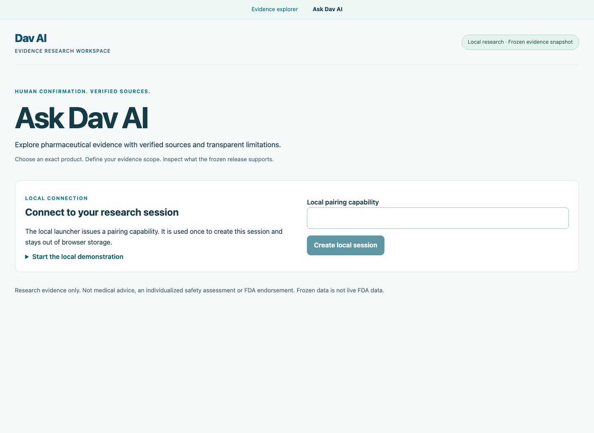

# Dav AI — Local Developer Demo Guide

This guide follows the implementation at `9e78e90`: a React workspace at `/ask`, a dedicated research API on `127.0.0.1:8001`, and optional local Ollama planning. It is not a hosted application launch guide or authorization to distribute the evidence database.

## Prerequisites

- An interactive terminal with `/dev/tty`. The launcher was exercised on macOS; portability to other systems is not certified here.
- Python 3.13 and a populated root `.venv`. CI targets Python 3.13 and Node 24. The audit machine reports Python 3.13.7, Node 25.9.0 and npm 11.12.1; Node 25 is an observation, not the documented CI target.
- Frontend dependencies installed from `frontend/package-lock.json`.
- The authorized frozen database already available at `data/releases/dav_ai_pharma_v1/phase4b-communications-2026-10-06/pharma.sqlite` (or the existing documented local artifact configuration). It is not included in Git and no public download URL is provided. Expected size: 4,825,108,480 bytes; SHA-256: `87779eda6b06c75f10603762b18f8c66a5cb7b12ed37d47ab1bf9b4825639c71`. Keep database, metadata and manifest unchanged, with publication unvalidated.
- For model planning only: already-running Ollama at `127.0.0.1:11434` and an installed approved model, `llama3.2:3b` or `qwen3.5:4b-q4_K_M`. Both models are not required. Explicit deterministic research works without Ollama. The selector lists only installed approved models detected by the server.

For a new developer environment, the repository/CI uses these dependency files and commands (dependency installation requires package-network access):

```bash
python3.13 -m venv .venv
.venv/bin/python -m pip install --require-hashes --only-binary=:all: -r backend/requirements-dev.txt
.venv/bin/python -m pip check
```

In `frontend`, run `npm ci`. Do not recreate or replace an already populated environment unnecessarily. These setup commands do not supply the database or models. The runtime-only backend lock does not include all local agent/development dependencies. No model download is needed for deterministic execution, and this guide does not initiate one.

## Start in two terminals

From the repository root, in **Terminal 1**:

```bash
PYTHONPATH=backend .venv/bin/python -m app.local_research
```

Actual terminal message:

```text
Local pairing capability (paste into Ask Dav AI; expires on server exit):
<64-character URL-safe capability generated for this process>
```

The bracketed text is explanatory, not a usable credential. The launcher generates 48 random bytes and delivers their URL-safe encoding directly to `/dev/tty`; there is no `dav_pair_` prefix, hex format, readiness banner or log-file token. It disables access logging. Keep the terminal open and the capability private. The pairing capability can create more than one session until server exit; each session gets a different bearer capability.

In **Terminal 2**, from the repository root:

```bash
cd frontend
npm run dev -- --host 127.0.0.1 --port 5173 --strictPort
```

Open **http://127.0.0.1:5173/ask**. Do not expose either development server with a public bind or tunnel. The ordinary evidence explorer at `/` separately uses its existing backend (default port 8000); that backend is not needed for `/ask`.

## Browser walkthrough

1. In the **Local pairing capability** field, paste the terminal token and click **Create local session**. This is a connection panel, not an account/login modal. Pairing input is cleared after session creation. Browser refresh loses the session credential.
2. In **Brand, ingredient or NDC**, enter `0009-0029` and click **Search**. Review strength, dosage form, product/package NDCs and ingredients. Results are eligibility-filtered and bounded; they do not expose every stored product.
3. Click the Xanax candidate card, then **Confirm selected product**. A singleton is still not auto-confirmed. The confirmed product is locked; use **New research session** to change products.
4. Edit **Research question** and choose one or more of **Drug labeling**, **Historical recalls**, **FAERS reporting evidence**. These explicit categories determine scope; the question is not a request for treatment advice.
5. Choose **Explicit deterministic execution**, or an actually installed local model under **Execution mode**. A model selection requests `auto` routing; valid incomplete plans may receive disclosed backend completion. No model is guaranteed to produce a valid plan.
6. Click **Research selected evidence**. The UI displays a truthful running state and polls a background task. It does not stream model tokens. Runtime varies with model loading, artifact verification and source reads; there is no 2–4 second result guarantee or zero-latency deterministic mode.
7. Inspect completed/partial results, source dates/URLs, coverage, expandable label text, ranked reactions and limitations. **Research execution details** distinguishes native model tools from backend-selected tools. The top five returned reaction terms are visible; additional returned terms and full provenance are expandable. A known UI limitation can show `Source URL unavailable` for an official download.open.fda.gov recall URL because the frontend link allowlist is narrower than the backend provenance validator. The typed evidence retains the citation; this documentation-only audit does not change that renderer.
8. **Cancel and close session** cancels in-flight research and invalidates the session. **New research session** closes it and requires pairing and confirmation again. A refresh/disconnect does not immediately cancel an accepted task; server deadlines, expiry and cleanup remain active.



[Desktop evidence results](screenshots/ask-local-results-desktop.png) · [Mobile results](screenshots/ask-local-results-mobile.png)

The preceding real browser verification of `0009-0029` with Qwen returned **partial**: no admitted exact-product label, incomplete historical recall coverage including `D-0161-2016`, and available alprazolam reporting evidence with 18 ingredient-report associations. This is an observed frozen-release case, not a promise for every query. Unknown/restricted lot scope remains visible. FAERS associations are not NDC-specific observations, incidence, causality, comparative safety or individual risk, and must not be summed across ingredients.

## CLI alternative

The CLI takes a required question argument; it does not repeatedly prompt for a search query/question:

```bash
PYTHONPATH=backend .venv/bin/python -m app.agent.cli \
  --query 0009-0029 \
  --question 'Retrieve labels, historical recalls and ingredient-level FAERS evidence.' \
  --categories labels recalls faers --routing deterministic
```

Inspect the numbered candidates and enter the intended product number at **Select product number**; empty input cancels. For installed model planning, replace `--routing deterministic` with `--routing auto --model qwen3.5:4b-q4_K_M`. Use `--routing model` to require a complete native plan. `--json` returns the full typed briefing; human-readable CLI output uses excerpts, while the browser exposes full retrieved label text. CLI sessions are process-owned and do not use browser pairing.

## Evaluation and regression commands

The framework entry point is `app.agent.evaluation.cli`. The older `research_evaluation` module is a separate six-case evaluator, not this three-mode CLI.

```bash
PYTHONPATH=backend .venv/bin/python -m app.agent.evaluation.cli --mode offline
PYTHONPATH=backend .venv/bin/python -m app.agent.evaluation.cli --mode frozen_data
PYTHONPATH=backend .venv/bin/python -m app.agent.evaluation.cli --mode model_comparison --smoke
```

Mode B needs the authorized frozen release; Mode C also needs installed approved models and local Ollama. `--smoke` selects eight corpus IDs, but Mode B further filters to frozen-data cases (six smoke cases); Mode A without `--smoke` selects all 35. Omit `--smoke` for a broader live run; do not equate it to the stored eight-case benchmark. To retain new results, use explicit **new** `--output`/`--report` paths after deciding whether they are private; do not overwrite or automatically publish historical artifacts.

Backend checks are listed in the [README](../../README.md#verification). In `frontend`, existing scripts are `npm run lint`, `npm run build`, `npm test`, `npm run test:e2e`. The separate real integration harness `PYTHONPATH=backend .venv/bin/python scripts/verify_ask_research.py` requires free ports 8001/15173, installed Chromium and the real artifact. It starts and cleans up its own loopback services and may use an installed model. It is not a download or deployment command.

## Troubleshooting

| Symptom | Check / response |
| --- | --- |
| API unavailable | Start Terminal 1 interactively; confirm the launcher is running on port 8001. A normal `app.main` process does not expose agent routes. |
| Noninteractive terminal error | Use a real terminal with `/dev/tty`; redirecting stdout is not capability delivery. |
| Ollama offline / no approved models | Use explicit deterministic execution, or check the separately managed local runtime and `ollama list`. No model pull is required by the app. |
| Pairing rejected | Copy the complete current terminal token; a restarted server issues a different one. Never put it in a URL or screenshot. |
| Session expired (410) | Lifetime is ten minutes **from creation**, not inactivity. Start a new session and confirm again. |
| Busy/capacity response (429) | One operation can run at a time and at most eight sessions are registered. Close sessions you own or wait for bounded work/expiry; do not bypass admission. |
| Port occupied | Identify the process you own and stop it normally in its terminal, or wait. Do not blindly kill every process using a port. |
| Origin/Host rejected (403) | Use the exact development URL. Both 127.0.0.1:5173 and localhost:5173 are admitted Origins; the API itself remains at 127.0.0.1:8001. LAN/public/other ports are denied. |
| Hosted-serving denial | Expected protection. Do not set local environment values to bypass it. |
| Missing/unauthorized artifact | Obtain access through the existing authorized artifact process. A Git clone is insufficient; do not regenerate the frozen release or change its publication flag. |
| Timeout or stopped plan | Inspect the safe error and start a new session if needed. Source/model/workflow limits remain active; do not manufacture evidence or silently retry research. |
