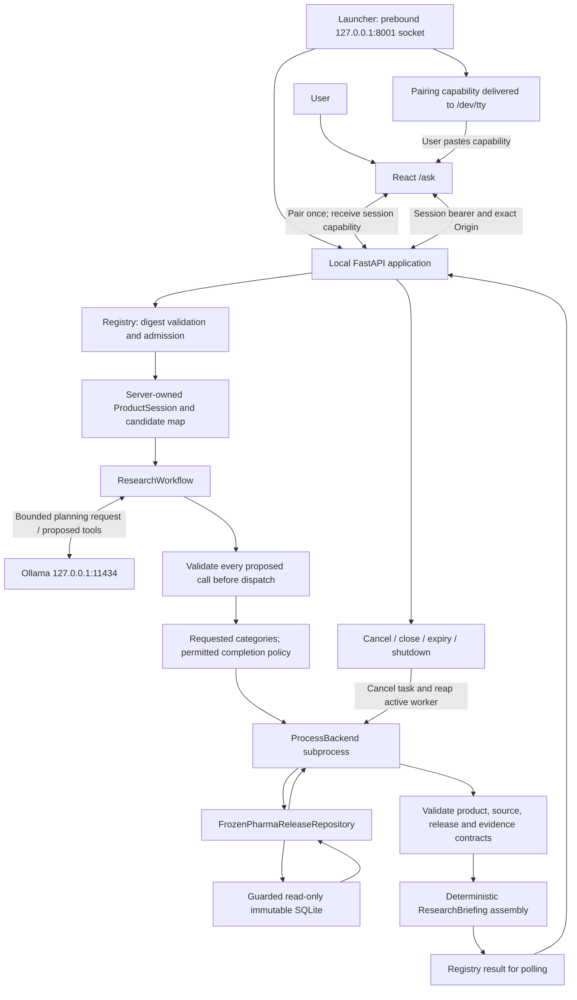

# Dav AI — Research Architecture and Local Trust Boundary

Implementation reviewed at application milestone `9e78e90`. This is a local research system with tested controls, not a claim of complete security or clinical correctness. The ordinary explorer API in `app.main` and the dedicated research API are separate applications; research routes are not mounted in the hosted app.

## Components and data flow



`ResearchWorkflow` calls `OllamaClient`; `ProcessBackend` does not run model inference. The LLM has no SQL/database connection, shell or confirmation tool. Search/confirmation use the server-owned `ProductSession`; inference starts only after explicit confirmation. Raw model text is discarded from the displayed evidence briefing. The model can still propose invalid calls, which must be rejected.

## Request sequence

```mermaid
sequenceDiagram
    actor Human as User
    participant UI as React workspace
    participant API as Local API and registry
    participant Session as ProductSession
    participant Flow as ResearchWorkflow
    participant LLM as Ollama
    participant Worker as ProcessBackend
    participant Repo as Frozen repository

    Human->>UI: Paste terminal pairing capability
    UI->>API: POST /sessions with pairing bearer
    API-->>UI: Opaque session ID, independent session capability
    Human->>UI: Search brand, ingredient or NDC
    UI->>API: POST /sessions/id/resolve with session bearer
    API->>Session: Resolve under trusted server owner
    Session->>Worker: Bounded resolver operation
    Worker->>Repo: Guarded read-only search
    Repo-->>Worker: Candidate products
    Worker-->>Session: Validated candidates
    Session-->>API: Display fields and random opaque refs
    API-->>UI: confirmation_required (including singleton)
    UI-->>Human: Display candidate cards
    Human->>UI: Select and explicitly confirm exact product
    UI->>API: POST /sessions/id/confirm with product_ref
    API->>Session: Verify binding and lock selection
    Session->>Worker: Re-read selected product
    Worker->>Repo: Guarded identity read
    Repo-->>Worker: Stored identity
    Worker-->>Session: Product projection
    Session-->>API: Confirmed identity
    API-->>UI: confirmed
    Human->>UI: Submit question and explicit categories
    UI->>API: POST /sessions/id/research
    API->>Flow: Start bounded asyncio task
    API-->>UI: running
    alt Model selected
        Flow->>LLM: Question, selected opaque ref, allowed schemas
        LLM-->>Flow: Proposed tool batch
        Flow->>Flow: Validate entire plan; reject invalid proposals
        opt Valid nonempty subset in auto mode
            Flow->>Flow: Record backend-completed missing tools
        end
    else Explicit deterministic execution
        Flow->>Flow: Use requested categories; no model call
    end
    loop Requested permitted evidence categories
        Flow->>Session: Reauthorize and reverify product binding
        Flow->>Worker: Fixed read-only source operation
        Worker->>Repo: Stored label / recall / ingredient evidence
        Repo-->>Worker: Evidence projection
        Worker-->>Flow: Bounded structured result
        Flow->>Flow: Validate source and scope; retain partial outcomes
    end
    Flow-->>API: Typed completed / partial / stopped result
    loop While running
        UI->>API: GET /sessions/id/result
        API-->>UI: running or terminal result
    end
    opt User cancels or closes
        Human->>UI: Cancel or new session
        UI->>API: POST cancel or close
        API->>Flow: Cancel active task; close session
        API-->>UI: stopped/cancelled or closed
    end
    Note over API,Worker: Expiry and shutdown also cancel tasks and reap workers
```

Confirmation responses return through API → frontend → user. The server does not directly ask a human a question. Polling is used, not SSE, WebSockets or streamed tokens. Disconnecting a browser does not automatically cancel an accepted asynchronous research job; its deadlines and expiry still apply.

## Ownership and local authentication

Source: `backend/app/local_research/api.py`, `__main__.py`; `frontend/src/research/client.ts` and `Workspace.tsx`.

- The launcher binds the actual IPv4 socket to `127.0.0.1:8001`. The factory checks that a supplied socket is loopback-bound; it can use a different bound port in tests. No public global ASGI app or environment enable flag is exported.
- Pairing uses `secrets.token_urlsafe(48)`; the 48 random bytes encode to a 64-character URL-safe token. It is reusable for session creation until server exit, **not single-use**. The launcher delivers it to `/dev/tty` and refuses a noninteractive terminal.
- Creation generates separate `token_urlsafe(32)` values for session ID, capability and private owner. The browser never supplies owner identity or a Python session. Registry capabilities are SHA-256 digests compared with `secrets.compare_digest`; live local principals/session objects remain server-side.
- The browser clears pairing input after creation, holds the session capability in memory, and sends Authorization headers to a fixed loopback URL. It uses no cookies, storage credentials, URL tokens or redirect following. Memory-only storage does not prevent malicious local code or a compromised trusted frontend from stealing a capability.
- Exact allowed Origins: `http://127.0.0.1:5173`, `http://localhost:5173`, `http://127.0.0.1:15173`. Missing/null/other Origins, wrong Host, non-loopback peers and recognized proxy forwarding headers are rejected. CORS omits credential permission; it is not authentication.
- Resolving again replaces candidate refs. Confirmation verifies the current map and freshly read product. Selected identity is locked; random `p_` references are not ULIDs. Wire contracts omit repository identity keys but preserve source-provenance identifiers.

## Routing and evidence contracts

| Routing | Behavior |
| --- | --- |
| `model` | Complete native plan required; a missing category stops with reason `incomplete_model_plan` |
| `auto` | A validated nonempty subset can receive backend completion of omitted explicitly requested categories |
| `deterministic` | Explicit categories map to permitted tools without inference; source reads still take time and can fail |

The browser exposes deterministic execution and model-selected `auto` execution. `routing.mode` records `model`, `deterministic` or `deterministic_completion`; actual `model_planned_tools` and `backend_completed_tools` remain separate. Unknown tools, extra arguments, duplicates, wrong refs or missing tool calls receive no completion fallback. Execution order and briefing assembly remain backend-controlled.

Labels retain admitted exact-product links and full stored text; absent fields are not evidence of no warnings. Recalls retain record classification, matched value/method, firm, reported status, dates and lot scope. FAERS is ingredient-level reporting evidence, with no product total or inference of causality, incidence, comparative safety or personal risk. Existing repository matching and aggregation are reused; no narrative is treated as evidence.

## Budgets, expiry and limitations

| Control | Actual default |
| --- | --- |
| Registry | Eight sessions; one active operation per process, including discovery/search/confirmation/research; nonwaiting 429 admission |
| HTTP body / server connections | 8,192 bytes; five-second body read deadline; launcher concurrency limit 32 |
| Session lifetime | 600 seconds **from creation**, not inactivity; sweeper every second; closed entries reclaimed |
| Browser research policy | One research start per session; new session requires fresh confirmation |
| Agent counters | Four iterations, four tool calls per session; at most three source tools/request; one attempt/category |
| Deadlines | Two-second model discovery; 45-second model call; 20-second source operation; 70-second workflow |
| Payloads | 12,288-byte prompt; 65,536-byte model/source JSON limits; 262,144-byte briefing |

`ProcessBackend` runs fixed read-only operations with no shell interpolation. Timeout/cancellation kills and reaps an unfinished child. This is not a container, seccomp sandbox, hard address-space limit or CPU quota. Serialized size limits do not bound every allocation before serialization. Some source failures preserve verified partial results; changed bindings, lost authorization and mixed releases prevent publication of an invalid combination. Close/cancel invalidates the session; restart/expiry loses state. There is no persistent queue, account system or distributed rate limiter.

## Frozen release and hosted-serving denial

`connect_release()` checks `is_deployed_environment()` before opening the checksum-pinned SQLite database using `mode=ro&immutable=1`, with query-only/read-only protections. File mode and SHA-256 checks establish expected artifact integrity; they are not cryptographic prevention of edits by an owner with filesystem privileges. `publication_validated=false` is release metadata; API `publication_authorized=false` is a projected disclosure, not a signed permission token.

The detector examines `DAVAI_ENV`, `APP_ENV`, `ENVIRONMENT`, `PYTHON_ENV` (any present value outside local/dev/development/test/testing denies) and `RENDER` (present and not `false`). It does not explicitly detect AWS, Vercel, Fly.io or Kubernetes markers. Local factory/startup/request guards reuse that detector; release access checks it again. Correct deployment configuration and isolation remain necessary; do not spoof environment values or tunnel the local listener.

See [release counts and scope](../../README.md#frozen-evidence-release), [evaluation limitations](../ai/AGENT_EVALUATION_RESULTS.md) and [publication blockers](../ai/PUBLICATION_READINESS_AUDIT.md).
