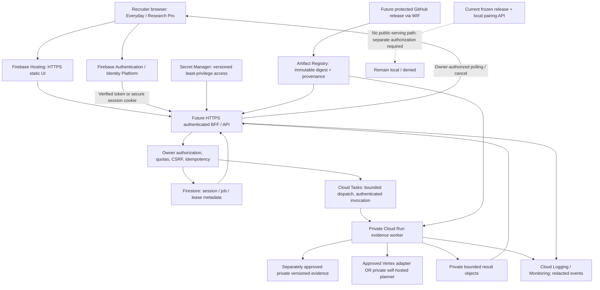

# GCP MLOps / LLMOps Foundation Report

2026-10-22. Branch: `feat/private-staging-authorization`. Committed baseline: `3a7f155` (portfolio documentation), application baseline `9e78e90`. **No GCP resources were created, no cloud authentication/billing setup was performed, and no deployment is authorized or claimed.**

## Audit findings and release blockers

The current index contains **25 staged dual-mode paths** from the user, including Everyday/Research Pro components, tests and screenshots. That milestone is **not committed**. Its index contents and worktree files were preserved byte-for-byte. This is a release-provenance blocker: images built from this working tree are engineering verification artifacts, not approved release candidates. Nothing was staged or committed by this task.

Actual current architecture:

- React 19/TypeScript/Vite exposes Everyday and Research Pro on shared `/ask` orchestration, plus the existing `/` explorer. A non-sensitive experience preference is stored locally. Research credentials remain component memory. The explorer client defaults to port 8000; research is hard-coded to the dedicated loopback API on 8001.
- Research Pro holds up to **50 selected cohort entries in browser memory**. Adding a candidate is not server-side confirmation of 50 products. Repeated searches can invalidate prior opaque refs. Deep research still uses one explicitly confirmed server-owned ProductSession and one bounded request; there is no batch API, durable job store or multiuser authentication.
- The local API has terminal pairing, per-session capabilities, exact Origin/Host/peer checks, ten-minute expiry, one active operation and eight-session admission. This is an intentionally local developer boundary, unsuitable for internet identity. It stays intact.
- FastAPI `app.main` exposes catalog/safety/evidence/report routes and preserves strict hosted startup denial. `connect_release()` rejects configured deployed modes before SQLite access. The local research factory also rejects hosted environments. Environment detection examines the actual existing markers; it is not an exhaustive GCP/cloud detector. GCP hosting would explicitly use staging/production, never spoof local mode.
- Agent v2 validates tool proposals, selected identity and source contracts, executes fixed read-only ProcessBackend subprocesses, and deterministically assembles briefings. Defaults remain 45-second model, 20-second source and 70-second workflow deadlines, bounded JSON, three requested evidence tools and four session tool calls. It is not a distributed queue or OS security sandbox.
- Frozen release: 4,825,108,480 bytes, mode 0444, SHA-256 `87779eda6b06c75f10603762b18f8c66a5cb7b12ed37d47ab1bf9b4825639c71`; metadata `publication_validated=false`. No artifact/manifest/guard was modified or bypassed. No evidence/model enters the new images.
- Existing backend Dockerfile, restrictive root build context, Vercel configuration, Render configuration, GitHub CI, dependency locks and ignore rules were inspected and left unchanged. Existing CI targets Python 3.13 and Node 24. Untracked ingestion/research files remain untouched. Existing publication/history/privacy/license review blockers still apply.

Staged code also needs release review: cohort status conversion currently recognizes `complete/completed` but not the briefing section state `available`; candidate refs are not durable cohort authority. This observation is from code inspection, not a new live defect reproduction. This task does not modify the staged application or claim Research Pro batch execution works.

## Implemented foundation versus design

| Implemented and locally testable | Deliberately not implemented/activated |
| --- | --- |
| Separate deny-only ASGI application, liveness and sanitized JSON telemetry | Public research/catalog endpoints or hosted auth |
| Digest-pinned multi-stage deny-image build with three hash-locked existing server dependencies | Any frozen-data reader or local capability reuse for internet users |
| Multi-stage frontend build ending in a scratch artifact, with no web server | A functioning hosted Everyday/Research Pro deployment |
| Default-zero-resource Terraform JSON; private/IAM-required service if later explicitly enabled | Cloud API activation, resources, buckets, secrets, model endpoints, IAM grants or WIF provider |
| Credential-free build/test/scan CI, pinned actions/provider/base images | Image push, OIDC credentials, real cloud plan/apply or automatic release |
| Mock-provider Terraform tests and application/policy regression tests | Batch execution, distributed sessions, Vertex/Ollama cloud adapters |

The deny image imports no Dav AI application modules, agent code, SQLite, database client or model SDK. Valid configuration permits only GET/HEAD `/health`; every other HTTP path/method returns `503 serving_not_authorized`. `/ready` deliberately denies. Unknown publication variables do not unlock it. Invalid hosted/data/key/model configuration fails startup and request checks. It never consumes denied request bodies, so no untrusted body is parsed into a job or session. This does not claim protection against every platform-level connection flood.

The launcher listens on all container interfaces as required by the runtime, but **no public service was created**. Local smoke ports were bound to `127.0.0.1`. Future template ingress is internal-only and IAM invoker checks remain enabled, without invoker grants. The runtime account has no project roles or dataset/model access. This is an independently isolated refusal boundary, not an alternative way to serve the unapproved frozen release.

## Proposed eventual GCP architecture (not provisioned)



The diagram is a target design, not evidence these services exist. No Kubernetes is justified for this small project.

### Hosting, ingress and job execution choices

Prefer **Firebase Hosting** for an eventual static UI: CDN/HTTPS and static releases avoid keeping a UI process warm. Cloud Run can host static files behind a BFF if a unified server/cookie boundary is preferable, at the cost of runtime requests and cold starts. The current SPA must first gain an explicitly reviewed hosted transport and identity flow; do not replace its loopback address or terminal pairing with an internet URL. Firebase-to-Cloud Run rewrites, user auth and IAM must be designed together: a browser's end-user ID token is not automatically a Cloud Run service-to-service invoker token. Public-facing app ingress, any BFF trust, and backend private ingress need separate review. [Cloud Run end-user authentication](https://docs.cloud.google.com/run/docs/authenticating/end-users).

Prefer **Cloud Tasks → private Cloud Run service** for bounded per-product work; the task owns an authenticated request until completion. Never transplant local background asyncio tasks into a request-based instance and assume they survive a 202 response. Cloud Run Jobs are an alternative for longer offline jobs, with task count/parallelism capped; do not launch 50 jobs/products in parallel. Retries are at-least-once, requiring application idempotency. [Cloud Run task execution](https://docs.cloud.google.com/run/docs/triggering/using-tasks), [billing/CPU allocation](https://docs.cloud.google.com/run/docs/configuring/billing-settings).

Firestore is proposed for small owner/session/job/lease records, not entire briefing blobs. Keep full bounded per-product results in a private object store, with owner-authorized retrieval and expiry enforcement. A future approved evidence bucket would have public-access prevention, uniform IAM, version/generation pinning and content hashes, with read-only worker access and separate ingestion identity. Do not mount/upload the current frozen database or make its publication field a runtime toggle. A 4.83 GB database and repeated worker verification also need cold-load, memory, ephemeral-storage and concurrency measurement; the tiny deny container's 512 MiB allocation is not a research sizing recommendation.

## Public data authorization and an isolated demo option

The existing release is **not authorized for deployed serving**. FDA-derived provenance alone does not resolve redistributability, artifact authorization, source-data completeness, privacy or product suitability. Publication/history/license review and explicit evidence-use approval remain prerequisites. Do not change metadata, manifest, environment detection or `connect_release()` to enable this milestone.

For a first recruiter demo, propose **separately approved synthetic fixtures** with fictional products/identifiers and explicit `Demonstration evidence — not real pharmaceutical research` labels on every result and export. Maintain an independent versioned fixture manifest/license, evidence kind, IDs, release hash and approval record. Do not silently label synthetic records as FDA evidence, substitute them for missing real labels, or reuse real NDCs to suggest real warnings. The future demo reader would be a separate fixture-only component that cannot load pharmaceutical paths; original frozen release guards stay unchanged. Fixture approval, schema design, tests and UI disclosure are a next milestone, not implemented here. Existing ProductSession authorization also rejects deployed environments, and ProcessBackend invokes the frozen pharmaceutical worker; neither can simply be mounted behind a hosted URL. A future fixture-only design needs separate hosted owner/session and fixture-backend implementations with their own reviewed evidence-kind contract. Reuse pure validation ideas where applicable, without monkeypatching local authorization or routing fixture requests through the frozen reader.

## Hosted identity, trust boundaries and abuse controls (design)

Use Firebase Authentication/Identity Platform or another established OIDC provider, with server SDK verification of signature, issuer, audience/project, expiry and revocation policy. Derive immutable user identity from verified claims, never a request's owner ID. Do not interpret a nonempty token as authenticated or trust a Cloud Run IAM service token as an end-user identity.

For a same-origin BFF, exchange a fresh verified sign-in for a short-lived Secure/HttpOnly/SameSite cookie, protect login/state changes against CSRF and validate exact Origin. A pure bearer design must keep tokens out of URLs/persistent application storage, restrict accepted audiences and origins, and handle XSS/token theft. Session-cookie creation and revocation need the documented provider flow. CORS is not authentication. [Firebase server session cookies](https://firebase.google.com/docs/auth/admin/manage-cookies).

| Threat / boundary | Required next implementation |
| --- | --- |
| Cross-user access / stale product refs | Server-owned sessions/jobs with verified subject membership on every read/write/cancel; random IDs; resolve/confirm fresh product binding in approved evidence scope; reject foreign or stale refs |
| CSRF / login substitution / XSS | Exact trusted HTTPS origins, protected sign-in exchange, anti-CSRF checks where cookies apply, CSP, no credential URLs, safe source links and frontend sanitization |
| Anonymous abuse / cost exhaustion | Require sign-in for research; tightly limited fixture-only guest mode only if separately approved; ingress controls, distributed per-user/project quotas and queue dispatch limits |
| Queue replay / duplicate execution | Deterministic idempotency keys and transactional leases; generation fencing on result publication; authenticated task audience/service identity; bounded retries and expiry |
| Prompt injection | Existing strict tool/reference schemas and full-plan validation; no direct SQL/shell/network tools; untrusted model/source text cannot authorize identity or write facts |
| Worker compromise | Separate least-privilege identities, non-root fixed image, limited CPU/memory/instance/timeout quotas, approved evidence-only access, minimal egress and dependency scans |
| Secrets / telemetry leakage | Secret Manager version references where actually needed; workload identity instead of key files; redacted structured logs, retention and access controls; never log credentials, questions or label text |
| HTTPS / trust confusion | TLS only at public ingress; private workers with service authentication; cookie transport restrictions; test spoofed forwarding headers and direct private-service invocation |

The current health-only application does not pretend to implement hosted authentication, jobs or these public product controls. Its lack of pharmaceutical functionality is the safe enforcement in this milestone.

## Research Pro batch design — disabled

The 50-entry UI limit is a selection limit, **not execution concurrency**. Do not add a client loop calling the local agent 50 times or share one ephemeral ProductSession across users/products.

Proposed initial, reviewable limits: one active batch/user, one product operation/user, at most one product dispatch globally while profiling, at most 50 confirmed distinct products/batch, 100 product operations/user/day, three approved evidence categories/product, and the existing 70-second product workflow budget. These are proposed ceilings, not installed quotas or a promise of capacity. At 50 × 70 seconds, a sequential batch could take about **58 minutes** before dispatch/retry overhead.

1. Create a server-owned cohort version with stable approved product identity and evidence release. Re-resolve every submitted selection and obtain explicit confirmation; browser NDC strings and expired local refs are not authority. Freeze the cohort/category/model/prompt versions at job acceptance.
2. Transactionally enforce user/project quotas, cohort size/duplicates and an idempotency key over subject, cohort version, categories, approved release, planner configuration and user request. Repeated acceptance returns the existing job rather than repeating cost.
3. Store compact parent job and per-product status/lease documents; use separate bounded result objects (50 × 256 KiB already exceeds one document). Leases use fencing tokens and attempt counters. The dispatch principal can invoke only the fixed private worker audience.
4. Workers claim one item, check cancellation/expiry, revalidate identity, run permitted source reads, and conditionally publish against their lease. A duplicate task returns an existing result. Retries are capped and distinguish transient infrastructure failure from invalid plans or permanent missing evidence.
5. Preserve `queued`, `running`, `completed`, `partial`, `failed`, `cancel_requested`, `cancelled`, `expired` job/item states. Do not relabel unavailable evidence as an error or missing fields as no warnings. Progress is completed-item counts, not fictional model steps.
6. Cancellation revokes further leases and fences late results. Stop an active subprocess/model request where supported; a task cancel is not proof all execution instantly stopped. Expiry is enforced on access independently of asynchronous TTL deletion.
7. Cache/reuse ingredient evidence only under matching approved release/scope/provenance keys. Never sum ingredient/product FAERS associations into a cohort total, invent a union count from aggregate data, or present comparative risk. Each record retains its original scope and limitations.
8. Proposed retention: sessions 30 minutes, task leases two minutes with bounded renewal, results 24 hours, restricted operational audit events seven days. Enforce result-byte/storage quotas, object lifecycle deletion and retries, with documented exceptions/incident retention. These values need a privacy/cost review; none are active.

## Model serving and LLMOps recommendation

Current client is fixed to loopback Ollama, with only `llama3.2:3b` and `qwen3.5:4b-q4_K_M`, no proxy/redirect/pull API. A remote Vertex or self-hosted cloud endpoint requires a separately reviewed adapter; an environment URL override is not an acceptable shortcut. The model remains a tool planner; deterministic backend logic owns identity, retrieval, counts and briefing text.

Recorded corpus 1.0.0 live run `run_mode_c_1792700694`: eight trials/model, one repetition. Llama exact plans **7/8**, overall case passes **7/8**, model/end-to-end medians **1.160/6.645 s**, one backend-completed trial. Qwen exact plans **8/8**, overall passes **6/8**, medians **3.023/8.811 s**, no backend completion. Three case predicates failed; the status-based safety scorer and report labels have known limitations. These are narrow local measurements, not production SLOs or guaranteed tool reliability. [Recorded evaluation details](../ai/AGENT_EVALUATION_RESULTS.md).

| Option | Compatibility / benefits | Costs / risks / required gate |
| --- | --- | --- |
| Vertex managed token-billed planner | Burst-oriented service with managed operations; avoids an always-warm GPU | Existing Ollama schema/wire protocol is not a drop-in adapter; Gemini or another managed model is a model change, not the Qwen/Llama benchmark. Validate function calls, refusals, token accounting, data handling, quotas, regional availability and model-version lifecycle before approval. No endpoint invoked here. |
| Private self-hosted approved Qwen/Llama | Can retain GGUF/digest and tool-planning comparison closer to local behavior, using a supported inference server | Paid CPU/GPU and operations; artifact pull, quantization/kernel differences and cold loads need measurement. Cloud Run GPU requires instance-based billing and minimum CPU/RAM sizing; GPU quota/availability is not assured. CPU-only may fit small low-QPS trials but no latency promise. |
| Explicit deterministic fixture demo | No inference bill, easy reproducibility and truthful execution provenance | Must clearly disclose no model planning; does not demonstrate hosted LLM inference and still requires approved fixtures/auth controls. |

Recommendation: approve the isolated fixture/deterministic demo first. For later low-volume hosted inference, evaluate a cost-capped managed planner before paying for a warm GPU; if exact Qwen/Llama parity is required, profile private self-hosted CPU and scale-to-zero GPU options instead. Neither provider nor model is selected/activated by this milestone. Upstream Qwen3.5-4B is marked Apache-2.0; Llama 3.2 uses its Community License. Review exact quantized artifact provenance, redistribution, attribution and acceptable-use terms separately—an upstream license label is not automatic clearance of a third-party GGUF. [Qwen model card](https://huggingface.co/Qwen/Qwen3.5-4B), [Llama license](https://huggingface.co/meta-llama/Llama-3.2-3B-Instruct/blob/main/LICENSE.txt), [Cloud Run GPU requirements](https://docs.cloud.google.com/run/docs/configuring/services/gpu).

Future provenance per accepted request/result should pin application image digest, model provider/version or weight digest/quantization, prompt/tool-schema hash, evaluation-corpus version, generation settings, requested/planned/backend-completed tools, approved evidence release/hash, run timing/token use and safe error codes. No chain-of-thought, raw prompts, credentials or complete source text in operational logs. Stable planner canaries, adversarial/schema tests, source-contract fidelity and refusal/partial-state checks must gate upgrades; the current scorer's blind spots need review before automatic model promotion. A failed evaluation must not silently switch provider, model or evidence class.

## Cost assumptions and controls

Illustrations checked against official pages on the audit date, in USD, using representative us-central1 list prices **before credits, free allowances, discounts, tax, egress or supporting services**. They are estimates, not quotes or committed bills. No inference call, cloud resource or chargeable infrastructure was created here.

| Assumed workload | Approximate compute/inference arithmetic |
| --- | --- |
| 1,000 CPU API requests, ten active seconds each, 1 vCPU / 0.5 GiB | At $0.000024/vCPU-s and $0.0000025/GiB-s: $0.24 CPU + $0.0125 memory, plus request/other charges |
| 1,000 managed planner requests, 2,000 input + 512 output tokens each | Illustrative listed Gemini 2.5 Flash Lite text rates $0.10/$0.40 per million input/output tokens give **$0.4048**; not a model approval, availability guarantee or full application cost |
| One continuously allocated non-zonal-redundant L4, 4 vCPU / 16 GiB | Listed GPU $0.0001867/s + CPU $0.000018/vCPU-s + memory $0.000002/GiB-s ≈ **$1.05/hour**, about **$764/730-hour month**; loading/warm time also costs |

Scale-to-zero can reduce idle compute, but adds cold starts. Multiple active revisions, retries, queue backlog, egress and model calls still cost. The template's maximum is one instance **per revision**; it is not a hard project-wide spending cap. [Cloud Run pricing](https://cloud.google.com/run/pricing), [managed model pricing](https://cloud.google.com/vertex-ai/generative-ai/pricing).

Other recurring costs: static Hosting storage/transfer, Artifact Registry storage/scanning, Firestore reads/writes/index/storage, Cloud Tasks operations, private object storage and retrieval, Secret Manager versions/access, Logging/Monitoring volume/retention, build minutes and optional domain/networking. Firebase/identity pricing depends on the chosen providers, usage and plan; avoid SMS/phone auth as an unbudgeted first-demo dependency. Do not assume trial credits, free inference or a free GPU. [Firebase pricing](https://firebase.google.com/pricing), [Firestore pricing](https://cloud.google.com/firestore/pricing), [Artifact Registry pricing](https://cloud.google.com/artifact-registry/pricing), [Secret Manager pricing](https://cloud.google.com/secret-manager/pricing).

Before any paid stage, approve a monthly budget and alerts, service-specific quotas, queue rate/backlog limits, maximum instances, per-user token/product-operation ceilings, bounded retries and a tested manual kill switch. Alert-only budgets are **not** hard caps; assess any available spend-cap feature's service coverage and behavior separately. A budget breach should first stop new dispatch/model calls and require owner review, not rely on an alert email alone. None of these billing controls were activated. [Google budget modes](https://docs.cloud.google.com/billing/docs/how-to/budgets).

## CI/CD and release provenance

Implemented `.github/workflows/gcp-foundation.yml` runs on relevant PR/main changes with **contents: read only**. Actions are pinned to verified release commit SHAs. It installs existing development dependencies, runs foundation/security/agent checks, validates locked Terraform and mock plans, scans IaC, builds both images, smoke-tests a read-only/non-root/limited local deny container, and fails HIGH/CRITICAL image vulnerability findings. There is no OIDC permission, secrets reference, image push, GCP login, API enablement, Terraform apply or deployment job. Existing CI remains unchanged and covers full backend/frontend regressions. Workflow syntax and commands were checked locally; no GitHub-hosted workflow execution was triggered here.

Future authorized delivery should separate untrusted PR checks from a protected release workflow. Use GitHub Actions **Workload Identity Federation**, not a JSON service-account key: restrict the provider to numeric repository owner/repository IDs, the expected issuer/audience, protected ref and approved release environment, with narrowly scoped service-account impersonation. Mint short-lived credentials only after approval, with separate image-publisher and release-deployer roles. Limit registry write to the target repository, service-account impersonation to the intended runtime identity and Cloud Run deployment to the reviewed service; no Owner/Editor or dataset/model access for builders. WIF/IAM trust still requires explicit provisioning/review; none exists in these templates. [Google deployment-pipeline WIF guidance](https://docs.cloud.google.com/iam/docs/workload-identity-federation-with-deployment-pipelines).

Require an immutable committed application revision (the staged dual-mode milestone must be reviewed/committed by its owner), passing tests/scans, SBOM/provenance, approved evidence class/manifest, model/prompt/schema versions and signed release metadata. Promote the same image digest through private staging and later approved demo rather than rebuilding a tag. The first registry/identity bootstrap and later image/service activation should be separate reviewed phases; a service cannot start from a digest that has not been published. IaC has no API auto-enablement and cannot bootstrap a real project implicitly.

## Observability, retention and incident response

Implemented foundation telemetry is one stdout JSON event per HTTP response: generated request ID, fixed route class, status, duration, severity/event. It logs no raw URL/query, request body/headers, credential, product ID, prompt or stack trace. Platform request/access logs are separate and need their own privacy/retention review; application redaction does not guarantee platform logs contain no user metadata. Keep questions and credentials out of URLs. The deny service's expected 503 responses are not a successful research-readiness metric.

Future private staging should add dashboards/alerts for health/startup failures, unexpected authorization successes, 401/403/429 trends, API/worker latency, queue depth/oldest age, task lease expiry, cancellations, retry attempts, invalid tool plans, deterministic completion, partial/unavailable evidence, model/token spend and stored result bytes. Use bounded low-cardinality labels; no user IDs, NDCs or prompts in metric dimensions. Per-owner audit records require restricted storage and a reviewed retention policy, not unrestricted logs.

Proposed launch SLO gates are operational tests, not promises: all unauthenticated/foreign-owner accesses denied; no pharmaceutical route succeeds in the foundation; accepted product work always reaches a terminal state/expiry within its configured job budget; dashboard distinguishes expected denial/partial evidence from server defects. Validate authentication, ingress, task retries, cancellation races, abuse limits and permission revocation in a separately approved private environment before public traffic.

Incident procedure: stop new task dispatch and model invocations; restrict ingress/invoker permissions; preserve minimal redacted event evidence; revoke affected hosted sessions and any compromised deployment identity; identify application/model/evidence digests; assess cross-owner access and source-scope violations; notify the responsible owner; remediate and pass the failed controls before reopening. Do not “recover” by setting local environment flags or changing publication metadata. No production incident-control automation was activated.

## Rollback and safe staging sequence

There is nothing deployed to roll back now. A future approved stage should start private, without public invoker bindings, using the deny image and liveness probe. A health response does not authorize data serving. Rollback restores the last reviewed **deny-only** image/configuration or disables new traffic/dispatch, not the legacy pharmaceutical API. Retain image digests and compatible job/lease schema versions; fence older worker generations before redirecting traffic. Avoid destructive state rollback or blind database restore. No current dataset should be altered in a rollback.

The Terraform resources have deletion protection/prevent-destroy where supported, so destruction is not the default rollback. Any bootstrap, IAM, quota or billing modification requires a separate reviewed operation. A future Terraform state backend must use access-controlled encrypted versioned storage with locking; the current templates do not provision that backend or store credentials. Do not commit state, plans, variable values or credential files. The module ignore rules exclude those local outputs while retaining the provider lock.

## Verification and scan results

Final executed results are recorded below after completion. Tools downloaded only to `/tmp` were Terraform 1.13.5 (archive SHA-256 verified against official checksums) and Trivy 0.76.1 (archive checksum verified); no models/datasets were downloaded. Provider 8.8.0 was signature-verified and locked for Linux amd64/macOS arm64. Actions and Node/Python image digests were resolved from official metadata. No cloud account was contacted or configured.

Initial full-runtime/slim image scanning reported **52 HIGH/CRITICAL package findings**, including inherited OS packages and unnecessary cryptography dependencies. That image was not approved. The foundation was narrowed to the already-pinned `click`, `h11`, `uvicorn` packages and a current digest-pinned Alpine Python base, without modifying the existing application lock or Dockerfile. Findings were not hidden with ignore rules, lowered severity or `ignore-unfixed`; final scans determine whether the candidate remains blocked.

| Executed check | Result |
| --- | --- |
| Foundation application/configuration tests | **39 passed** |
| Full backend, `-m 'not release_artifact'` | **971 passed, 27 skipped, 7 deselected**, 15.59 s; one preexisting Starlette/httpx deprecation warning |
| Agent suite | **177 passed**, 6.10 s |
| Security suite | **246 passed**, 0.26 s |
| Required release-artifact gate | **7 passed**, 370 deselected, 8.15 s; publication approval unchanged |
| Frontend lint / TypeScript + Vite build | Passed |
| Frontend unit/component tests | **42 passed** across eight files |
| Existing Playwright journeys | **5 passed**, 2.9 s, including dual-mode; localhost/mocked API journeys |
| Docker builds | Deny image built for Linux arm64 and final Linux amd64; multi-stage frontend scratch artifact built locally |
| Final Linux amd64 deny-container smoke | Passed liveness, business/session/batch denial, redacted logs, non-root/read-only runtime, loopback binding and absence of runtime pip/evidence |
| Terraform 1.13.5, provider 8.8.0 | `validate` passed; **3 mocked tests passed**, no real cloud plan/apply; `fmt -check -recursive` passed |
| Actionlint | Passed new credential-free workflow |
| Trivy 0.76.1, final deny image | **0 HIGH/CRITICAL findings** with the current database; scan succeeded without exceptions |
| Trivy, frontend scratch artifact | Scan succeeded; no language package files detected in static output; not a JavaScript dependency security certification |
| Trivy, Terraform configuration | **0 HIGH/CRITICAL findings**; this is not a complete IAM/deployment security review |
| Git whitespace / preservation | `git diff --check` passed; original index and preexisting file hashes verified unchanged |

Agent/security/foundation counts are subsets of the full backend suite, not additional independent coverage. Skips are existing optional PostgreSQL ingestion tests without a disposable database; required artifact checks ran separately. Models, live inference benchmarks, cloud authentication, cloud integration and a hosted user journey were **not** executed. Frontend build/test results describe the staged working tree, not an immutable committed release.

Docker Desktop was initially stopped and was started for these **local** builds/checks. Temporary smoke containers were removed; no image was pushed. After confirming no containers remained active, Docker Desktop was returned to its initially stopped state. Terraform initially needed permission for its provider's local IPC socket; permitted validation/mock tests passed. The initial YAML/shell lint issues were corrected before the final successful checks. The Playwright test regenerated three staged screenshots; their exact original staged blobs were restored after verifying the pre-task hashes, without changing the index. All preexisting source, research and screenshot contents match the original snapshot.

The minimized image first retained four HIGH findings in unused installer/vendor packages. Removing runtime package installers (not excluding findings) produced the final clean HIGH/CRITICAL scan. The final candidate's local Linux amd64 image digest is `sha256:2321316f0ea30363da1995cac072b35301392d5f838cd7642a1f708736c1aa82`. Lower-severity findings, future vulnerability databases, upstream runtime-lock vulnerabilities outside the foundation, provenance/license review and cloud security acceptance remain separate concerns. A scan pass is not a safety certification or release approval. CI is linted and its component commands were exercised locally, but no remote CI run was triggered.

The release gate verified the pinned frozen SHA-256. Database size/mode and `publication_validated=false` remain unchanged. No original release reader, manifest, deployed detection, local pairing flow, agent orchestration or hosting/privacy setting was altered.

## Exact changed-file list and recommended staging

All **16 files** below are new foundation files; no preexisting application/configuration file was edited:

1. `.github/workflows/gcp-foundation.yml`
2. `deployment/README.md`
3. `deployment/foundation/__init__.py`
4. `deployment/foundation/app.py`
5. `deployment/foundation/requirements.lock`
6. `deployment/foundation/Dockerfile`
7. `deployment/foundation/Dockerfile.dockerignore`
8. `deployment/frontend/Dockerfile`
9. `deployment/frontend/Dockerfile.dockerignore`
10. `deployment/gcp/.gitignore`
11. `deployment/gcp/.terraform.lock.hcl`
12. `deployment/gcp/main.tf.json`
13. `deployment/gcp/tests/foundation.tftest.hcl`
14. `backend/tests/deployment_foundation/test_foundation.py`
15. `backend/tests/deployment_foundation/test_configuration.py`
16. `docs/deployment/GCP_MLOPS_FOUNDATION_REPORT.md`

Recommendations only; **not executed**. Your existing 25 dual-mode staged paths remain in the index. Do not accidentally commit that milestone and this foundation together without reviewing their separate scopes; this task neither stages nor unstages those paths.

```bash
git diff --check
git add -- .github/workflows/gcp-foundation.yml \
  deployment/README.md \
  deployment/foundation/__init__.py \
  deployment/foundation/app.py \
  deployment/foundation/requirements.lock \
  deployment/foundation/Dockerfile \
  deployment/foundation/Dockerfile.dockerignore \
  deployment/frontend/Dockerfile \
  deployment/frontend/Dockerfile.dockerignore \
  deployment/gcp/.gitignore \
  deployment/gcp/.terraform.lock.hcl \
  deployment/gcp/main.tf.json \
  deployment/gcp/tests/foundation.tftest.hcl \
  backend/tests/deployment_foundation/test_foundation.py \
  backend/tests/deployment_foundation/test_configuration.py \
  docs/deployment/GCP_MLOPS_FOUNDATION_REPORT.md
git diff --cached --name-only
git diff --cached --check
```

No commit, push, apply, deploy, billing or visibility command is recommended as part of this milestone.

## Next milestones and remaining authorization gates

1. **Baseline and publication review:** Owner reviews/commits the existing dual-mode implementation; resolve cohort status/reference issues, tracked history/privacy/license risks and exact evidence redistribution/public-serving authorization. This task cannot commit it on the owner's behalf.
2. **Approved fixture-only recruiter demo:** Approve a synthetic evidence package and clear demo disclosure, implement an independent fixture-only reader, verified hosted identity/session ownership and same-origin transport, then test Everyday and single-product Research Pro end to end in an approved private environment. Frozen pharmaceutical guards remain unchanged. No real-data promise or silent mock substitution.
3. **Hosted jobs and batch security:** Implement durable owner-scoped sessions/jobs, idempotency/leases, distributed quotas, cancellation/fencing, expiry/result retention and the bounded 50-selection design. Keep batch execution unavailable until tests/security review pass.
4. **Planner adapter evaluation:** If approved, implement a model-version-pinned managed or self-hosted adapter, review exact licenses/data handling, repair/evaluate scorer blind spots, measure cold and steady-state budgets, and enforce cost limits before enabling paid inference.
5. **Separately authorized private GCP staging:** Approve project/billing/budget, existing APIs, private state backend, WIF trust/IAM scopes, registry/image bootstrap, policy/scans, monitoring and rollback drills. Verify private ingress and foreign-owner/unauthenticated denial with actual cloud identities. Do not infer permission from these templates.
6. **Explicit public release decision:** Only after those controls and product/data/legal reviews, authorize a specific recruiter-accessible HTTPS release with documented supported evidence class, quotas, limitations and incident ownership. Public application access is not implemented or approved today.
